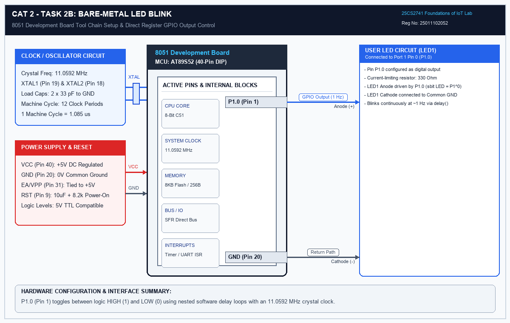

# EXPERIMENT DETAILS

**EXP:** CONTINUOUS ASSESSMENT 2

**DATE:** 20/07/2026

**NAME OF EXP:** 8051 Development Board Tool Chain Setup & Bare-Metal LED Blink

**HARDWARE SETUP / PLATFORM:** 8051 Microcontroller (AT89S52) + Keil µVision C51 + USB-ISP Programmer

---

## TASK 2B : Bare-Metal LED Blink via Direct Register Access

### 1. Circuit Diagram

The circuit demonstrates GPIO output control using an AT89S52 8051 microcontroller development board.

- **Microcontroller:** AT89S52 (40-Pin DIP)
- **Clock Circuit:** 11.0592 MHz Quartz Crystal with dual 33 pF ceramic capacitors (1 machine cycle = 1.085 µs)
- **Power Supply:** +5V DC regulated rail, Pin 40 (VCC), Pin 20 (GND), Pin 31 (EA/VPP tied to VCC)
- **GPIO Port & Pin:** Port 1, Pin 0 (P1.0) configured as push-pull output
- **Peripheral:** User LED in series with a 330 Ω current-limiting resistor connected between P1.0 and GND

### 2. Core Logic / Pseudocode / Code Base

**Working Principle:**

The microcontroller directly manipulates the special function register bit corresponding to Port 1 Pin 0 (`sbit LED = P1^0`). Driving P1.0 HIGH (logic 1, +5V) creates a forward potential difference across the LED and current-limiting resistor, turning the LED ON. Driving P1.0 LOW (logic 0, 0V) cuts current flow, turning the LED OFF. A software delay loop provides human-observable 1 Hz alternation.

**Pseudocode:**
1. Include `<reg51.h>` for AT89S52 special function register definitions.
2. Define `LED` alias mapped to Port 1 bit 0 (`P1^0`).
3. Define software delay function with nested decrement loops.
4. In `main()`:
   a. Initialize Port 1 pins to LOW state (`P1 = 0x00`).
   b. Enter infinite loop (`while (1)`).
   c. Set `LED = 1` (turn LED ON).
   d. Execute `delay()`.
   e. Set `LED = 0` (turn LED OFF).
   f. Execute `delay()`.
   g. Repeat endlessly.

**Code Structure:**
- Header: `#include <reg51.h>`
- Pin Definition: `sbit LED = P1^0;`
- Execution: Direct memory-mapped bit toggling within non-terminating loop.

### 3. Inference

The bare-metal firmware successfully established fundamental GPIO output control on the AT89S52. The user LED connected to P1.0 toggles at a steady 1 Hz frequency. The experiment verified correct toolchain configuration, compilation to Intel HEX format, and hardware programming.
