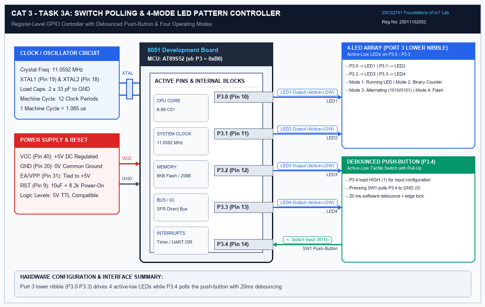

# EXPERIMENT DETAILS

**EXP:** CONTINUOUS ASSESSMENT 3

**DATE:** 27/07/2026

**NAME OF EXP:** Timer-Based LED Pattern Generator and Button Interrupt Controller

**HARDWARE SETUP / PLATFORM:** 8051 Microcontroller (AT89S52) + 4-LED Array + Push-Button Switch + Keil C51

---

## TASK 3A : Switch Polling and Four-State LED Mode Controller

### 1. Circuit Diagram

The circuit implements a multi-mode user-interface subsystem using four active-low LEDs and a debounced push-button switch.

- **Microcontroller:** AT89S52 (Clock: 11.0592 MHz)
- **Power & Reset:** +5V DC, Power-on reset circuit (10 µF capacitor + 8.2 kΩ resistor)
- **LED Array (Outputs):** P3.0 (LED1), P3.1 (LED2), P3.2 (LED3), P3.3 (LED4) in active-low configuration
- **Push-Button (Input):** P3.4 connected to a tactile momentary switch pulled to GND upon press

### 2. Core Logic / Pseudocode / Code Base

**Working Principle:**

Port 3 lower nibble drives four active-low LEDs, while P3.4 is configured as an input by maintaining a logic 1 in its latch. An active button press pulls P3.4 LOW. A 20 ms debounce delay filters mechanical bounce. A dedicated state variable (`mode`) cycles sequentially across 4 distinct visual patterns:
1. **Mode 1 (Running LED):** Sequential ring counter (`0001` -> `0010` -> `0100` -> `1000`).
2. **Mode 2 (Binary Counter):** 4-bit binary up-counter (`0000` to `1111`).
3. **Mode 3 (Alternating Pattern):** Complementary patterns (`1010` <-> `0101`).
4. **Mode 4 (All LED Flash):** Synchronous flashing (`1111` <-> `0000`).

**Pseudocode:**
1. Configure P3.4 as input (`BTN = 1`) and initialize LEDs OFF (`P3 = 0x1F`).
2. Continuously poll `BTN == 0`.
3. If pressed, execute 20 ms debounce delay, re-verify state, increment `mode = (mode + 1) % 4`, and block until button release.
4. Execute non-blocking step for active mode with periodic switch checks.

**Code Structure:**
- Special Function Register: `sfr LED_PORT = 0xB0;`
- Pin Bit: `sbit BTN = P3^4;`
- Masking: `LED_PORT = (LED_PORT & 0xF0) | (~pattern & 0x0F);` to preserve P3.4 state.

### 3. Inference

Switch polling with 20 ms debounce filtering completely eliminated contact bounce, ensuring exactly one state transition per physical press. All four LED operational patterns executed reliably, validating responsive finite state machine design in 8051 Embedded C.
