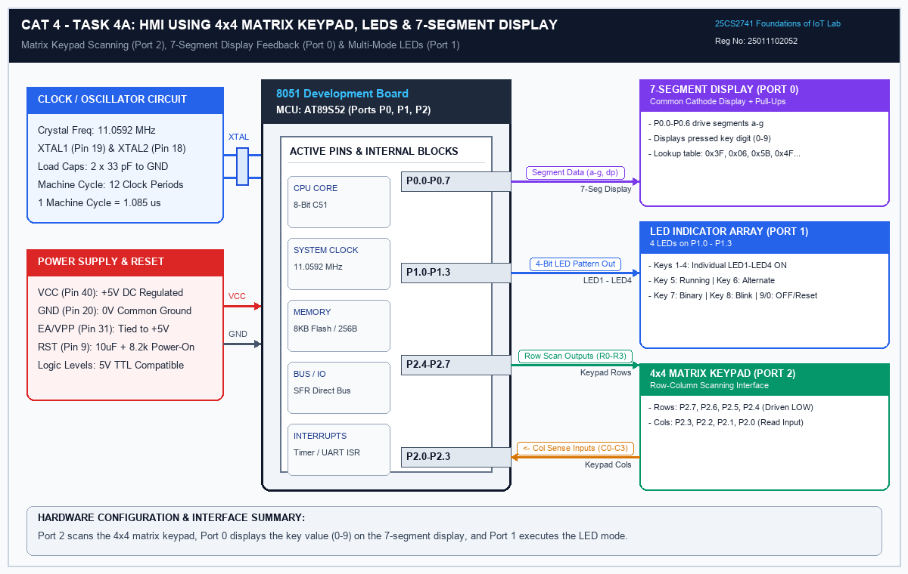

# EXPERIMENT DETAILS

**EXP:** CONTINUOUS ASSESSMENT 4

**DATE:** 03/08/2026

**NAME OF EXP:** Human-Machine Interface using Matrix Keypad, LEDs, and Seven-Segment Display

**HARDWARE SETUP / PLATFORM:** 8051 Microcontroller (AT89S52) + 4×4 Matrix Keypad + 7-Segment Display + 4-LED Array

---

## TASK 4A : Integrated Matrix Keypad Scanning with 7-Segment & LED Actuation

### 1. Circuit Diagram

The circuit establishes a comprehensive human-machine interface combining matrix keypad input, 7-segment numerical feedback, and multi-mode LED output.

- **Microcontroller:** AT89S52 (11.0592 MHz Crystal)
- **Keypad Matrix (Port 2):** Rows connected to P2.7–P2.4 (scan outputs); Columns to P2.3–P2.0 (sense inputs)
- **7-Segment Display (Port 0):** Common-cathode display connected to P0.0–P0.6 through a 10 kΩ pull-up resistor pack
- **LED Array (Port 1):** P1.0–P1.3 driving 4 individual indicator LEDs

### 2. Core Logic / Pseudocode / Code Base

**Working Principle:**

The 4×4 keypad is scanned using row-column multiplexing: each row is driven LOW sequentially while column pins are read. When a key press is detected, the key value (0–9) is looked up in a seven-segment cathode encoding table (`0x3F, 0x06, 0x5B, 0x4F, 0x66, 0x6D, 0x7D, 0x07, 0x7F, 0x6F`) and displayed on Port 0. Concurrently, Port 1 executes the corresponding LED function:
- Keys 1–4: Turn ON individual LEDs (LED1 to LED4).
- Key 5: Running LED pattern.
- Key 6: Alternating LED pattern (`1010` <-> `0101`).
- Key 7: 4-bit binary counter (`0–15`).
- Key 8: All LEDs blinking synchronously.
- Key 9: All LEDs OFF.
- Key 0: System reset.

**Pseudocode:**
1. Initialize `P0 = 0x00` (Display blank) and `P1 = 0x00` (LEDs OFF).
2. Call `keypad_scan()`: sequentially assert P2 rows LOW and inspect column bits.
3. If valid key returned:
   a. Update Port 0 with `digit[value]`.
   b. Switch execution mode to matched key.
4. Execute selected pattern while checking for subsequent keypad inputs.

**Code Structure:**
- Functions: `keypad_scan()`, `display_digit()`, `led_control()`, `running_led()`, `binary_counter()`, `blink_all()`.

### 3. Inference

The matrix scanning algorithm successfully resolved all 16 key intersections with zero ghosting. The 7-segment display gave instant numerical confirmation, and Port 1 mapped keypad commands to distinct LED behaviors seamlessly.
