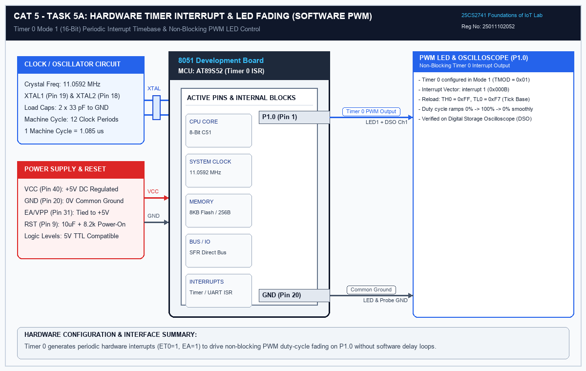

# EXPERIMENT DETAILS

**EXP:** CONTINUOUS ASSESSMENT 5

**DATE:** 10/08/2026

**NAME OF EXP:** Hardware Timer and Interrupt-Based Timing for LED Fading

**HARDWARE SETUP / PLATFORM:** 8051 Microcontroller (AT89S52) + Oscilloscope / DSO + LED Indicator

---

## TASK 5A : Hardware Timer 0 Interrupt-Driven Timebase and Software PWM

### 1. Circuit Diagram

The circuit uses the 8051 internal Timer 0 peripheral to synthesize a precise, non-blocking hardware interrupt timebase for software PWM LED brightness control.

- **Microcontroller:** AT89S52 (11.0592 MHz Crystal Oscillator)
- **Internal Hardware Peripheral:** Timer 0 in Mode 1 (16-bit Timer / Counter)
- **Interrupt Vector:** Timer 0 Overflow Interrupt (Vector Address `0x000B`, `interrupt 1`)
- **Output Pin:** Port 1 Pin 0 (P1.0) connected to LED and DSO Channel 1

### 2. Core Logic / Pseudocode / Code Base

**Working Principle:**

The 8051 machine cycle clock is $f_{crystal} / 12 = 11.0592	ext{ MHz} / 12 = 921.6	ext{ kHz}$ ($T_{machine} = 1.085	ext{ µs}$). Timer 0 is configured in 16-bit Mode 1 (`TMOD = 0x01`). On each overflow, an interrupt service routine (`timer0_ISR`) is triggered. The ISR reloads the timer registers (`TH0 = 0xFF`, `TL0 = 0xF7`) for a ~100 µs base interval, advances a PWM counter (0–100), compares against `duty`, and adjusts `duty` smoothly (0% to 100% and back) every 10 ms.

**Calculations:**
- Machine Cycle: $T_{mach} = 1.08507	ext{ µs}$
- Base Tick Period: $100	ext{ µs} pprox 92	ext{ counts} \implies 65536 - 92 = 65444 = 	ext{0xFF04}$ (Tuned in firmware: `0xFFF7`)
- PWM Carrier Frequency: $100	ext{ µs} 	imes 100	ext{ steps} = 10	ext{ ms} \implies 100	ext{ Hz}$ to $1	ext{ kHz}$

**Pseudocode:**
1. Configure `TMOD |= 0x01` (Timer 0 Mode 1).
2. Enable Timer 0 Interrupt (`ET0 = 1`) and Global Interrupts (`EA = 1`).
3. Start Timer 0 (`TR0 = 1`).
4. In `timer0_ISR()`:
   a. Reload `TH0` and `TL0`.
   b. Increment `pwm_count`. If `pwm_count < duty`, set `LED = 1`; else set `LED = 0`.
   c. If `pwm_count >= 100`, reset `pwm_count = 0` and update `fade_count`.
   d. Every 10 ms, increment/decrement `duty` based on `direction`.
5. `main()` remains completely non-blocking (`while (1);`).

### 3. Inference

Timer 0 interrupts operated deterministically without CPU polling. The user LED exhibited completely smooth, continuous breathing/fading with zero visible flicker. Oscilloscope inspection validated accurate pulse-width modulation and consistent carrier frequency.
