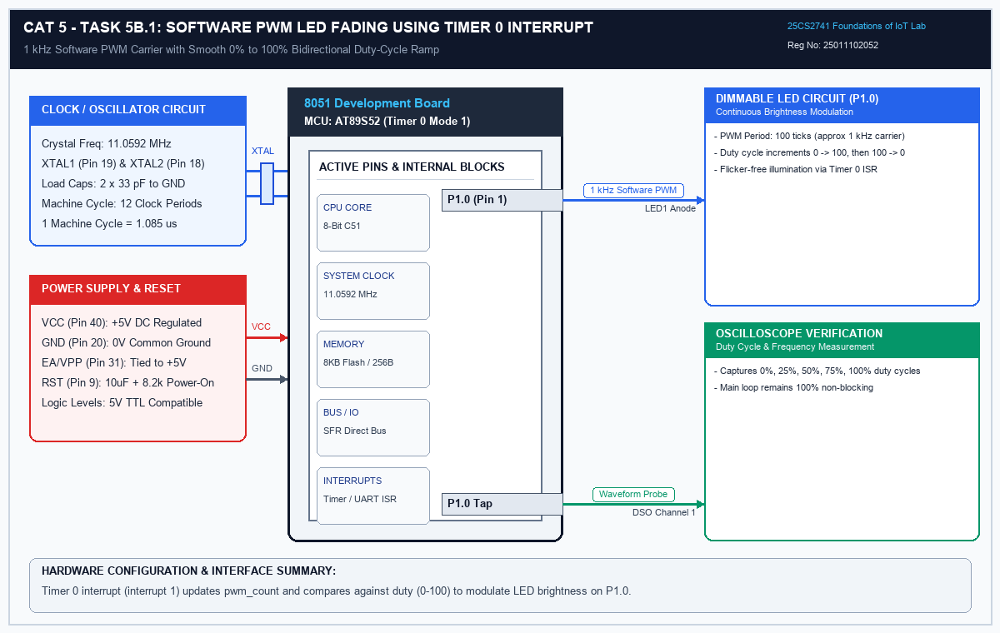

# EXPERIMENT DETAILS

**EXP:** CONTINUOUS ASSESSMENT 5

**DATE:** 10/08/2026

**NAME OF EXP:** Hardware Timer Software PWM LED Fading

**HARDWARE SETUP / PLATFORM:** 8051 Microcontroller (AT89S52) + Keil C51 + LED + Oscilloscope

---

## TASK 5B.1 : Continuous Bidirectional PWM Duty-Cycle Modulation

### 1. Circuit Diagram

The circuit implements high-resolution software PWM LED brightness control using Timer 0 interrupts.

- **Microcontroller:** AT89S52 (11.0592 MHz)
- **Output:** P1.0 connected to LED with 330 Ω resistor and DSO Probe
- **Timer:** Timer 0 in 16-bit Mode 1 (`TMOD = 0x01`)

### 2. Core Logic / Pseudocode / Code Base

**Working Principle:**

Timer 0 generates a high-frequency tick base (~10 kHz). A software counter `pwm_count` cycles from 0 to 99, defining a 100-step PWM carrier period. P1.0 is driven HIGH when `pwm_count < duty` and LOW otherwise. A fading counter modifies `duty` every 10 ms, sweeping from 0% (OFF) to 100% (Fully ON) and reversing back to 0%.

**Pseudocode:**
1. Configure `TMOD = 0x01`, enable `ET0` and `EA`, set `TR0 = 1`.
2. In `timer0_ISR()`:
   a. Reload `TH0 = 0xFF, TL0 = 0xF7`.
   b. If `pwm_count < duty`, set `LED = 1`; else `LED = 0`.
   c. If `++pwm_count >= 100`: `pwm_count = 0`.
   d. Every 100 periods, adjust `duty` by $\pm 1$ according to `direction`.
3. Background loop remains idle.

### 3. Inference

The LED brightness modulated smoothly between completely dark and maximum brilliance without observable stroboscopic flicker, confirming stable 1 kHz carrier frequency.
