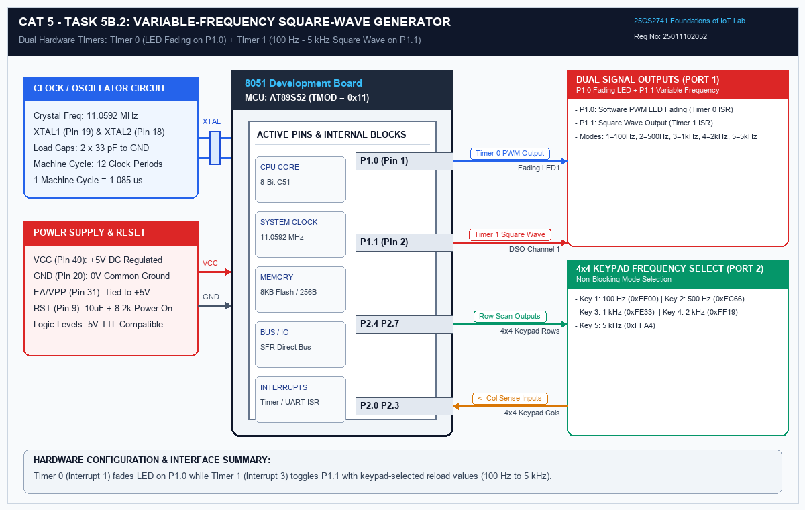

# EXPERIMENT DETAILS

**EXP:** CONTINUOUS ASSESSMENT 5

**DATE:** 10/08/2026

**NAME OF EXP:** Variable-Frequency Square-Wave Generation via Dual Hardware Timers

**HARDWARE SETUP / PLATFORM:** 8051 Microcontroller (AT89S52) + 4×4 Matrix Keypad + DSO Oscilloscope

---

## TASK 5B.2 : Keypad-Controlled Variable-Frequency Waveform Generator

### 1. Circuit Diagram

The circuit generates precise square-wave signals across five discrete frequencies using Timer 1 while maintaining non-blocking LED fading on Timer 0.

- **Microcontroller:** AT89S52 (11.0592 MHz)
- **Timer 0:** Mode 1, LED Fading Output on P1.0
- **Timer 1:** Mode 1, Variable Frequency Output on P1.1
- **Keypad Matrix (Port 2):** Keys 1–5 select 100 Hz, 500 Hz, 1 kHz, 2 kHz, and 5 kHz

### 2. Core Logic / Pseudocode / Code Base

**Working Principle:**

Both timers operate concurrently (`TMOD = 0x11`). Timer 0 controls P1.0 LED fading. Timer 1 toggles P1.1 on every interrupt. The Timer 1 reload value (`TH1`/`TL1`) is dynamically altered based on matrix keypad inputs:
- **Mode 1 (Key 1 - 100 Hz):** Half-period 5 ms $\implies$ Preload `0xEE00`
- **Mode 2 (Key 2 - 500 Hz):** Half-period 1 ms $\implies$ Preload `0xFC66`
- **Mode 3 (Key 3 - 1 kHz):** Half-period 500 µs $\implies$ Preload `0xFE33`
- **Mode 4 (Key 4 - 2 kHz):** Half-period 250 µs $\implies$ Preload `0xFF19`
- **Mode 5 (Key 5 - 5 kHz):** Half-period 100 µs $\implies$ Preload `0xFFA4`

**Pseudocode:**
1. Configure `TMOD = 0x11`, enable `ET0, ET1, EA`.
2. In `timer1_ISR()`: reload `TH1 = reload_high, TL1 = reload_low`, toggle `OUTPUT = !OUTPUT`.
3. In `main()`: poll keypad; on valid press, update `reload_high` and `reload_low` atomically.

### 3. Inference

The oscilloscope confirmed sharp square waves at 100 Hz, 500 Hz, 1 kHz, 2 kHz, and 5 kHz with exactly 50% duty cycle upon keypad selection.
