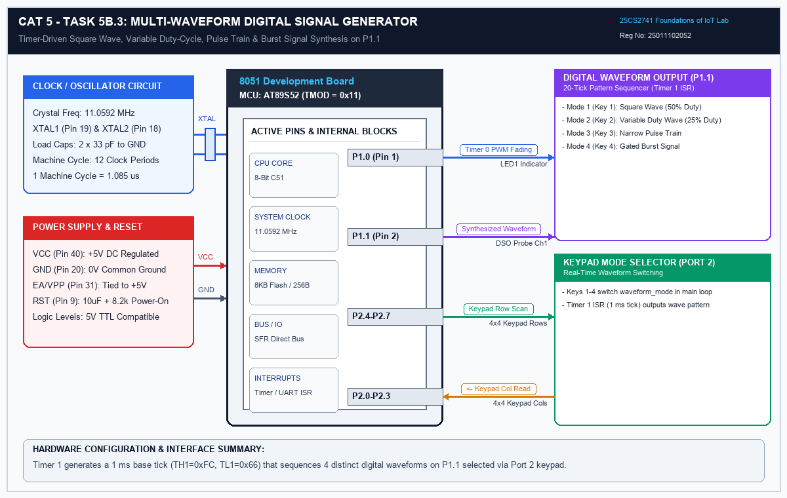

# EXPERIMENT DETAILS

**EXP:** CONTINUOUS ASSESSMENT 5

**DATE:** 10/08/2026

**NAME OF EXP:** Multi-Waveform Digital Signal Synthesizer

**HARDWARE SETUP / PLATFORM:** 8051 Microcontroller (AT89S52) + 4×4 Keypad + DSO Oscilloscope

---

## TASK 5B.3 : Synthesis of Square, Asymmetric, Pulse Train, and Burst Waveforms

### 1. Circuit Diagram

The circuit generates four distinct digital signal types on P1.1 using a deterministic 1 ms Timer 1 state-machine timebase.

- **Microcontroller:** AT89S52 (11.0592 MHz)
- **Waveform Output:** Port 1 Pin 1 (P1.1)
- **Keypad Interface:** Port 2 (Keys 1–4)

### 2. Core Logic / Pseudocode / Code Base

**Working Principle:**

Timer 1 operates as a 1 ms tick generator (`TH1 = 0xFC, TL1 = 0x66`). An internal tick counter `wave_tick` sequences 20-slot repeating pattern frames:
1. **Mode 1 (Square Wave):** Toggles every 10 ms (10 ticks HIGH, 10 ticks LOW, 50 Hz).
2. **Mode 2 (Variable Duty Wave):** 5 ticks HIGH, 15 ticks LOW (25% Duty Cycle).
3. **Mode 3 (Pulse Train):** 1 tick HIGH, 19 ticks LOW (5% Narrow Impulse).
4. **Mode 4 (Burst Signal):** 10-tick active square pulse burst followed by 10-tick silent pause.

**Pseudocode:**
1. In `timer1_ISR()`: reload `TH1=0xFC, TL1=0x66`, increment `wave_tick = (wave_tick + 1) % 20`.
2. Switch on `waveform_mode` and set `OUTPUT` HIGH or LOW according to frame slot.
3. In `main()`: non-blocking keypad scan updates `waveform_mode`.

### 3. Inference

All four waveform profiles were captured and verified on the digital oscilloscope, demonstrating versatile pattern generation using timer interrupts.
