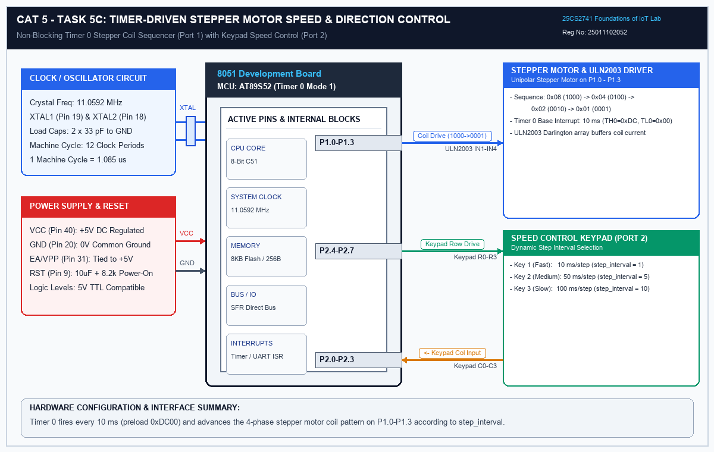

# EXPERIMENT DETAILS

**EXP:** CONTINUOUS ASSESSMENT 5

**DATE:** 10/08/2026

**NAME OF EXP:** Stepper Motor Speed and Direction Controller

**HARDWARE SETUP / PLATFORM:** 8051 Microcontroller (AT89S52) + ULN2003 Driver + 4-Phase Unipolar Stepper Motor

---

## TASK 5C : Non-Blocking Timer-Driven Stepper Motor Actuation with Keypad Speed

### 1. Circuit Diagram

The circuit controls the stepping sequence and rotation velocity of a 4-phase unipolar stepper motor using Timer 0 interrupts and a ULN2003 Darlington driver array.

- **Microcontroller:** AT89S52 (11.0592 MHz)
- **Motor Driver:** ULN2003 high-current Darlington transistor array
- **Phase Outputs:** P1.0 (Phase A), P1.1 (Phase B), P1.2 (Phase C), P1.3 (Phase D)
- **Keypad Controls:** Port 2 (Keys 1, 2, 3 select Fast, Medium, Slow speeds)

### 2. Core Logic / Pseudocode / Code Base

**Working Principle:**

The unipolar stepper motor requires wave drive or full-step coil energization. Port 1 outputs the 4-step sequence: `0x08 (1000)` -> `0x04 (0100)` -> `0x02 (0010)` -> `0x01 (0001)`. Timer 0 generates a 10 ms base interrupt tick (`TH0 = 0xDC, TL0 = 0x00`). A step divider advances coil excitation every `step_interval` ticks:
- **Key 1 (Fast):** `step_interval = 1` $\implies$ 10 ms/step
- **Key 2 (Medium):** `step_interval = 5` $\implies$ 50 ms/step
- **Key 3 (Slow):** `step_interval = 10` $\implies$ 100 ms/step

**Pseudocode:**
1. Initialize `coil = 0x08`, `P1 = coil`. Configure `TMOD = 0x01`, enable `ET0, EA`.
2. In `timer0_ISR()`:
   a. Reload `TH0 = 0xDC, TL0 = 0x00`.
   b. Increment `timer_count`. If `timer_count >= step_interval`:
      Rotate `coil` right circular: `coil = (coil >> 1) | ((coil & 1) ? 0x08 : 0); P1 = coil; timer_count = 0;`
3. In `main()`: poll keypad to dynamically reassign `step_interval`.

### 3. Inference

The stepper motor rotated smoothly without step slipping or excessive thermal buildup across all three speed presets, verifying accurate timing coordination.
