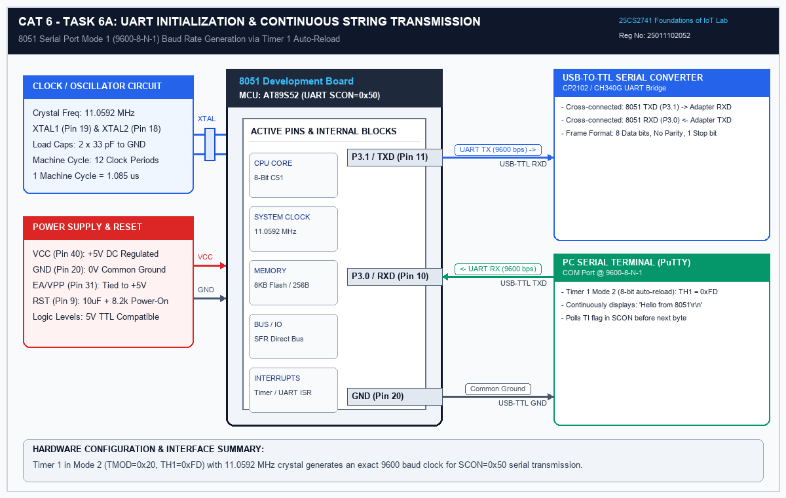

# EXPERIMENT DETAILS

**EXP:** CONTINUOUS ASSESSMENT 6

**DATE:** 17/08/2026

**NAME OF EXP:** UART Driver Development and Serial Debugging

**HARDWARE SETUP / PLATFORM:** 8051 Microcontroller (AT89S52) + CP2102 USB-to-TTL Serial Bridge + PuTTY Terminal

---

## TASK 6A : 8051 UART Driver Initialization and Continuous String Transmission

### 1. Circuit Diagram

The circuit establishes asynchronous serial communication between the 8051 microcontroller and a host PC serial terminal at standard 9600-8-N-1 settings.

- **Microcontroller:** AT89S52 (11.0592 MHz Quartz Crystal)
- **Serial Pins:** P3.1 (TXD - Pin 11) connected to USB-TTL RXD; P3.0 (RXD - Pin 10) connected to USB-TTL TXD
- **Ground Reference:** Pin 20 (GND) tied to USB-TTL GND
- **Host Interface:** PuTTY / Tera Term Terminal configured at 9600 Baud, 8 Data Bits, No Parity, 1 Stop Bit

### 2. Core Logic / Pseudocode / Code Base

**Working Principle:**

The 8051 UART uses Timer 1 in Mode 2 (8-bit auto-reload, `TMOD |= 0x20`) for baud rate generation. The baud rate equation is:
$$	ext{Baud Rate} = rac{2^{SMOD}}{32} 	imes rac{f_{osc}}{12 	imes (256 - TH1)}$$
For $f_{osc} = 11.0592	ext{ MHz}$, $SMOD = 0$, and Baud Rate = 9600 bps:
$$256 - TH1 = rac{11.0592 	imes 10^6}{32 	imes 12 	imes 9600} = 3 \implies TH1 = 256 - 3 = 253 = 	ext{0xFD}$$
Setting `SCON = 0x50` configures 8-bit UART with receiver enabled (`REN = 1`). Characters are loaded into `SBUF`, and the hardware `TI` (Transmit Interrupt) flag is polled until completion.

**Pseudocode:**
1. Configure `SCON = 0x50` (Mode 1, 8-bit UART, REN=1).
2. Configure `TMOD |= 0x20` (Timer 1 Mode 2 auto-reload).
3. Set `TH1 = 0xFD`, start Timer 1 (`TR1 = 1`).
4. In `UART_TxChar(char ch)`:
   a. Write `SBUF = ch`.
   b. Wait until `TI == 1`.
   c. Clear `TI = 0`.
5. In `UART_TxString(char *str)`: iterate string and transmit each character.
6. In `main()`: continuously transmit `"Hello from 8051\r\n"` with delay.

### 3. Inference

The PC terminal received and rendered `"Hello from 8051"` continuously with zero framing errors or character corruption, confirming mathematically exact baud rate timing.
