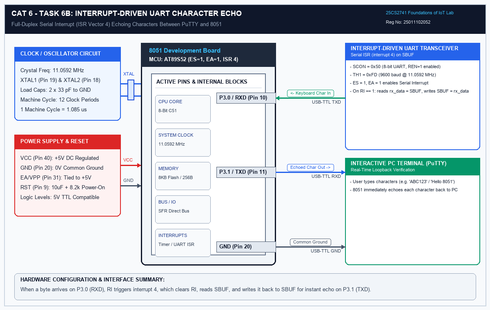

# EXPERIMENT DETAILS

**EXP:** CONTINUOUS ASSESSMENT 6

**DATE:** 17/08/2026

**NAME OF EXP:** Interrupt-Driven UART Character Echo

**HARDWARE SETUP / PLATFORM:** 8051 Microcontroller (AT89S52) + USB-to-TTL Serial Bridge + PuTTY Terminal

---

## TASK 6B : Interactive Serial Interrupt-Driven (ISR Vector 4) Full-Duplex Echo

### 1. Circuit Diagram

The circuit implements an interactive, interrupt-driven serial transceiver that instantly echoes user keyboard inputs back to the host console.

- **Microcontroller:** AT89S52 (11.0592 MHz Crystal)
- **UART Interface:** P3.1 (TXD) and P3.0 (RXD) cross-connected to USB-TTL converter
- **Interrupts:** Serial Interrupt Vector `0x0023` (`interrupt 4`), Global Interrupt Enable (`EA = 1, ES = 1`)

### 2. Core Logic / Pseudocode / Code Base

**Working Principle:**

Rather than tying up CPU cycles polling status flags, the Serial Interrupt (`ES = 1`) triggers `serial_interrupt() interrupt 4` upon character arrival (`RI == 1`) or transmission completion (`TI == 1`). When the user strikes a key in PuTTY, the incoming byte is latched into `SBUF`, raising `RI`. The ISR acknowledges the interrupt (`RI = 0`), extracts `rx_data = SBUF`, and immediately reloads `SBUF = rx_data` to transmit it back to the terminal.

**Pseudocode:**
1. Configure `SCON = 0x50`, `TMOD |= 0x20`, `TH1 = 0xFD`, `TR1 = 1`.
2. Enable Serial Interrupt (`ES = 1`) and Global Interrupt (`EA = 1`).
3. In `serial_interrupt() interrupt 4`:
   a. If `RI == 1`: clear `RI = 0`, read `rx_data = SBUF`, write `SBUF = rx_data`.
   b. If `TI == 1`: clear `TI = 0`.
4. In `main()`: enter non-blocking idle loop (`while (1)`).

### 3. Inference

Full-duplex serial loopback executed with zero keystroke loss. Strings typed interactively (e.g., `"ABC123"`, `"Hello 8051"`) were echoed back instantly, demonstrating efficient interrupt-driven serial I/O.
