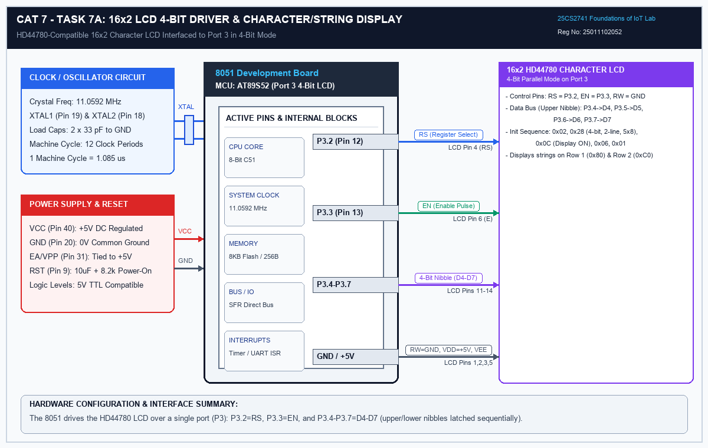

# EXPERIMENT DETAILS

**EXP:** CONTINUOUS ASSESSMENT 7

**DATE:** 24/08/2026

**NAME OF EXP:** 16×2 LCD Driver Development and Dynamic Display Control

**HARDWARE SETUP / PLATFORM:** 8051 Microcontroller (AT89S52) + HD44780-Compatible 16×2 Character LCD + Keil C51

---

## TASK 7A : 4-Bit GPIO-Based LCD Initialization and Text Display

### 1. Circuit Diagram

The circuit interfaces an industry-standard HD44780 16×2 alphanumeric LCD to Port 3 of the 8051 in 4-bit bus mode.

- **Microcontroller:** AT89S52 (11.0592 MHz)
- **LCD Control Lines:** P3.2 (RS - Register Select), P3.3 (EN - Enable Strobe), RW tied to GND (Write-Only)
- **LCD Data Lines (4-Bit):** P3.4 (D4), P3.5 (D5), P3.6 (D6), P3.7 (D7)
- **Power & Contrast:** LCD Pin 1 (VSS/GND), Pin 2 (VDD/+5V), Pin 3 (V0 contrast via 10 kΩ pot)

### 2. Core Logic / Pseudocode / Code Base

**Working Principle:**

Operating the HD44780 in 4-bit mode halves the required I/O pins from 8 to 4. Each 8-bit command or character byte is partitioned into upper and lower nibbles, transmitted sequentially on P3.4–P3.7, and latched via high-to-low pulses on Enable (`EN = P3.3`).

**Initialization Sequence:**
1. Wait >15 ms post power-up.
2. Send `0x02` to force 4-bit initialization.
3. Send `0x28`: 4-bit bus mode, 2 display lines, 5×8 font.
4. Send `0x0C`: Display ON, cursor OFF, blink OFF.
5. Send `0x06`: Entry mode, increment cursor automatically.
6. Send `0x01`: Clear display memory (DDRAM).

**Pseudocode:**
1. Define `lcd_nibble(val, rs)`: set `RS = rs`, mask upper nibble onto `P3`, pulse `EN = 1; delay; EN = 0`.
2. Define `lcd_cmd(cmd)`: send upper nibble, then lower nibble with `RS = 0`.
3. Define `lcd_data(dat)`: send upper nibble, then lower nibble with `RS = 1`.
4. In `main()`: call `lcd_init()`, display text strings on Row 1 (`0x80`) and Row 2 (`0xC0`).

### 3. Inference

The 16×2 LCD initialized reliably and rendered sharp, steady text strings across both rows, confirming correct 4-bit bus latching and command timing according to the HD44780 datasheet.
