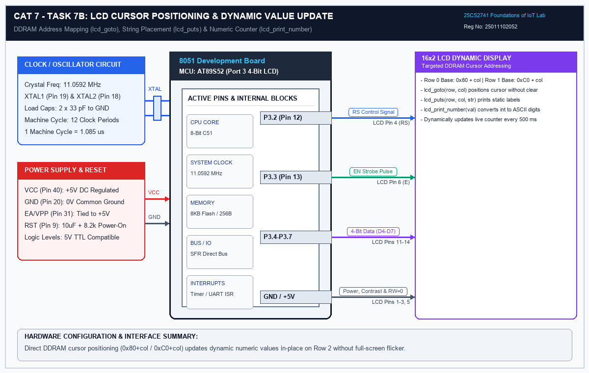

# EXPERIMENT DETAILS

**EXP:** CONTINUOUS ASSESSMENT 7

**DATE:** 24/08/2026

**NAME OF EXP:** LCD Cursor Positioning and Dynamic Value Update

**HARDWARE SETUP / PLATFORM:** 8051 Microcontroller (AT89S52) + 16×2 Alphanumeric LCD + Keil C51

---

## TASK 7B : DDRAM Cursor Positioning and Live Numerical Display Refresh

### 1. Circuit Diagram

The circuit implements precise DDRAM cursor positioning (`lcd_goto`), formatted string output (`lcd_puts`), and decimal number rendering (`lcd_print_number`) on a 16×2 LCD.

- **Microcontroller:** AT89S52 (11.0592 MHz)
- **LCD Connections:** Port 3 (RS=P3.2, EN=P3.3, D4–D7=P3.4–P3.7, RW=GND)

### 2. Core Logic / Pseudocode / Code Base

**Working Principle:**

The HD44780 DDRAM address for Line 1 ranges from `0x00` to `0x27` (Command `0x80 | col`), while Line 2 ranges from `0x40` to `0x67` (Command `0xC0 | col`). `lcd_goto(row, col)` positions the hardware cursor directly without clearing the display screen. Numerical integer values are converted to ASCII digits via modulo-10 decomposition and displayed dynamically.

**Pseudocode:**
1. In `lcd_goto(row, col)`:
   - If `row == 0`, send command `0x80 + col`.
   - If `row == 1`, send command `0xC0 + col`.
2. In `lcd_print_number(val)`: convert value to character array and transmit via `lcd_data()`.
3. In `main()`:
   a. Display static label `"Count: "` on Line 1.
   b. In `while (1)`: position cursor at Line 2 Col 0, print incrementing counter value, wait 500 ms.

### 3. Inference

Targeted DDRAM cursor positioning eliminated screen clearing flicker. The numeric counter incremented dynamically and rendered cleanly on Row 2.
