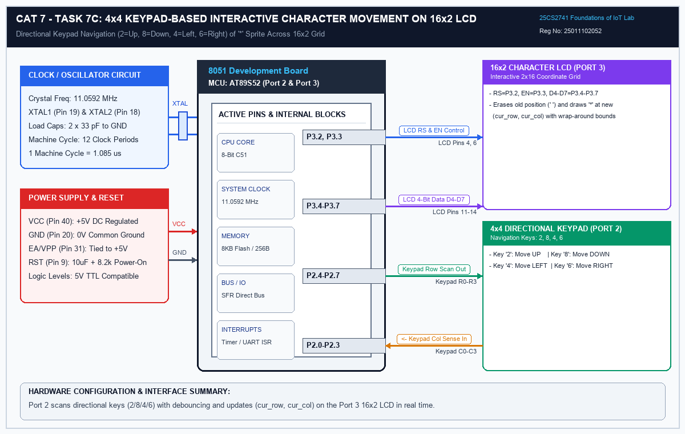

# EXPERIMENT DETAILS

**EXP:** CONTINUOUS ASSESSMENT 7

**DATE:** 24/08/2026

**NAME OF EXP:** 4×4 Keypad-Based Character Movement on 16×2 LCD

**HARDWARE SETUP / PLATFORM:** 8051 Microcontroller (AT89S52) + 4×4 Matrix Keypad + 16×2 LCD

---

## TASK 7C : Interactive Directional Keypad Navigation on a 2×16 Character Coordinate Grid

### 1. Circuit Diagram

The circuit creates an interactive embedded game/interface where a character sprite (`'*'`) navigates across the 16×2 LCD grid in response to directional keypad inputs.

- **Microcontroller:** AT89S52 (11.0592 MHz)
- **LCD Interface:** Port 3 (P3.2 to P3.7)
- **Keypad Matrix:** Port 2 (Rows P2.7–P2.4, Columns P2.3–P2.0)
- **Directional Key Mapping:** Key 2: Move UP, Key 8: Move DOWN, Key 4: Move LEFT, Key 6: Move RIGHT

### 2. Core Logic / Pseudocode / Code Base

**Working Principle:**

The display surface is represented as a 2-row by 16-column matrix (`cur_row` $\in [0,1]$, `cur_col` $\in [0,15]$). When a directional key is pressed:
1. The character at the previous position is erased by writing a blank space (`' '`).
2. Coordinate variables are updated with wrap-around boundaries:
   - UP (Key 2): `cur_row = 0`
   - DOWN (Key 8): `cur_row = 1`
   - LEFT (Key 4): `cur_col = (cur_col == 0) ? 15 : cur_col - 1`
   - RIGHT (Key 6): `cur_col = (cur_col + 1) % 16`
3. The cursor is repositioned via `lcd_goto(cur_row, cur_col)`, and the sprite (`'*'`) is printed.

**Pseudocode:**
1. Initialize LCD and place `'*'` at `(0, 0)`.
2. Loop continuously: scan Keypad on Port 2.
3. On key detection:
   a. Erase previous sprite (`lcd_goto(old_r, old_c); lcd_data(' ');`).
   b. Calculate new coordinates based on pressed key.
   c. Draw sprite at new position (`lcd_goto(new_r, new_c); lcd_data('*');`).
   d. Wait for key release.

### 3. Inference

The interactive sprite moved smoothly across the 16×2 coordinate space in all four directions with boundary wrap-around, validating responsive matrix input decoding and LCD cursor control.
