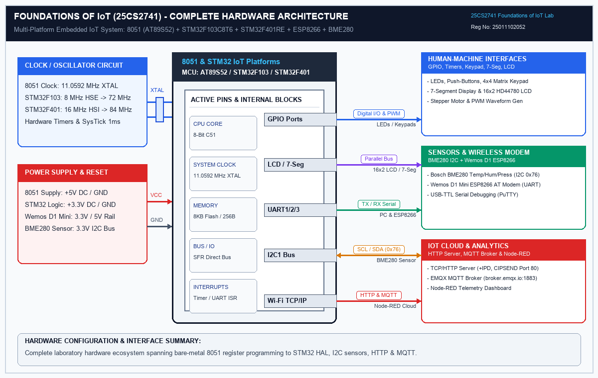

# Foundations of IoT (25CS2741) – Laboratory Repository

**Course:** 25CS2741 Fundamentals of Internet of Things + Lab  
**Student Name:** Maitreyan Jai Shankar  
**Register Number:** 25011102053  
**Department:** Computer Science & Engineering (IoT), Shiv Nadar University Chennai  
**Repository:** `25011102053_FIoT_LAB`

---

## 1. System Architecture & Complete Circuit Overview

This repository contains all experimental deliverables, bare-metal firmware, HAL-based drivers, project configuration files, and documentation following the course module schedule and Continuous Assessment Tests (CAT 2 through CAT 14).

---

## 2. Comprehensive Course Module & Laboratory Index

The laboratory tasks are organized into platform folders (`8051/` and `STM32/`), structured by assessment number and divided into modular subtasks. Each task contains its dedicated Keil / CubeMX project, source code, hex firmware, pinout schematic (`circuit.png`), and formal laboratory documentation (`README.md`).

### Platform I: 8051 Microcontroller (AT89S52)

| Assessment & Week | Task Identifier | Experiment Title & Scope | Project Location | Documentation |
|:---|:---|:---|:---|:---|
| **CAT 2 (Week 2)** | TASK 2B | Bare-Metal LED Blink via Direct Register Access | [TASK2B](8051/CAT2/TASK2B) | [README.md](8051/CAT2/TASK2B/README.md) |
| **CAT 3 (Week 3)** | TASK 3A | Switch Polling & 4-Mode LED Pattern Controller | [TASK3A](8051/CAT3/TASK3A) | [README.md](8051/CAT3/TASK3A/README.md) |
| **CAT 4 (Week 4)** | TASK 4A | HMI Interface: 4×4 Matrix Keypad, 7-Segment Display & LEDs | [TASK4A](8051/CAT4/TASK4A) | [README.md](8051/CAT4/TASK4A/README.md) |
| **CAT 5 (Week 5)** | TASK 5A | Hardware Timer 0 Interrupt & Software PWM LED Fading | [TASK5A](8051/CAT5/TASK5A) | [README.md](8051/CAT5/TASK5A/README.md) |
| **CAT 5 (Week 5)** | TASK 5B | Software PWM LED Fading & Variable Waveform Synthesis | [TASK5B](8051/CAT5/TASK5B) | [TASK5B Subtasks](8051/CAT5/TASK5B) |
| ↳ *Subdivision* | TASK 5B.1 | Software PWM LED Fading (0% to 100% Ramp) | [TASK5B.1](8051/CAT5/TASK5B/TASK5B.1) | [README.md](8051/CAT5/TASK5B/TASK5B.1/README.md) |
| ↳ *Subdivision* | TASK 5B.2 | Variable-Frequency Square-Wave Generator (100 Hz–5 kHz) | [TASK5B.2](8051/CAT5/TASK5B/TASK5B.2) | [README.md](8051/CAT5/TASK5B/TASK5B.2/README.md) |
| ↳ *Subdivision* | TASK 5B.3 | Multi-Waveform Synthesizer (Pulse Train, Duty, Burst) | [TASK5B.3](8051/CAT5/TASK5B/TASK5B.3) | [README.md](8051/CAT5/TASK5B/TASK5B.3/README.md) |
| **CAT 5 (Week 5)** | TASK 5C | Stepper Motor Step & Direction Control with Keypad Speed | [TASK5C](8051/CAT5/TASK5C) | [README.md](8051/CAT5/TASK5C/README.md) |
| **CAT 6 (Week 6)** | TASK 6A | UART Initialization & String Transmission (9600-8-N-1) | [TASK6A](8051/CAT6/TASK6A) | [README.md](8051/CAT6/TASK6A/README.md) |
| **CAT 6 (Week 6)** | TASK 6B | Interrupt-Driven Full-Duplex UART Character Echo | [TASK6B](8051/CAT6/TASK6B) | [README.md](8051/CAT6/TASK6B/README.md) |
| **CAT 7 (Week 7)** | TASK 7A | 16×2 HD44780 LCD 4-Bit Initialization & Text Display | [TASK7A](8051/CAT7/TASK7A) | [README.md](8051/CAT7/TASK7A/README.md) |
| **CAT 7 (Week 7)** | TASK 7B | LCD Cursor Positioning & Dynamic Numeric Counter | [TASK7B](8051/CAT7/TASK7B) | [README.md](8051/CAT7/TASK7B/README.md) |
| **CAT 7 (Week 7)** | TASK 7C | Interactive 4×4 Keypad Character Navigation on 16×2 Grid | [TASK7C](8051/CAT7/TASK7C) | [README.md](8051/CAT7/TASK7C/README.md) |

---

### Platform II: STM32 Microcontrollers (STM32F103C8T6 & STM32F401RETx)

| Assessment & Week | Task Identifier | Target Hardware & Scope | Project Location | Documentation |
|:---|:---|:---|:---|:---|
| **CAT 8 (Week 8)** | TASK 8A | STM32F103 Blue Pill: GPIO Input/Output (Switch-Following LED) | [TASK8A](STM32/CAT8/TASK8A) | [README.md](STM32/CAT8/TASK8A/README.md) |
| **CAT 8 (Week 8)** | TASK 8B | STM32F103 Blue Pill: Event-Based Control with Debouncing | [TASK8B](STM32/CAT8/TASK8B) | [README.md](STM32/CAT8/TASK8B/README.md) |
| **CAT 8 (Week 8)** | TASK 8C | STM32F103 Blue Pill: Short vs Long Press Duration Detection | [TASK8C](STM32/CAT8/TASK8C) | [README.md](STM32/CAT8/TASK8C/README.md) |
| **CAT 9 (Week 9)** | TASK 9A | STM32F103 Blue Pill: USART1 Transmission & Echo (115200-8-N-1) | [TASK9A](STM32/CAT9/TASK9A) | [README.md](STM32/CAT9/TASK9A/README.md) |
| **CAT 9 (Week 9)** | TASK 9B | STM32F103 Blue Pill: String-Based UART Command Interface | [TASK9B](STM32/CAT9/TASK9B) | [README.md](STM32/CAT9/TASK9B/README.md) |
| **CAT 10 (Week 10)** | TASK 10A | STM32–Wemos ESP8266 UART Link Setup (AT Verification) | [TASK10A](STM32/CAT10/TASK10A) | [README.md](STM32/CAT10/TASK10A/README.md) |
| **CAT 10 (Week 10)** | TASK 10B | Investigation of ESP8266 AT Command Interface | [TASK10B](STM32/CAT10/TASK10B) | [README.md](STM32/CAT10/TASK10B/README.md) |
| **CAT 10 (Week 10)** | TASK 10C | Wi-Fi Station Association (AT+CWJAP) & Network IP Audit | [TASK10C](STM32/CAT10/TASK10C) | [README.md](STM32/CAT10/TASK10C/README.md) |
| **CAT 11 (Week 11)** | TASK 11A | Static HTTP Server (AT+CIPSERVER=1,80, +IPD Parsing) | [TASK11A](STM32/CAT11/TASK11A) | [README.md](STM32/CAT11/TASK11A/README.md) |
| **CAT 11 (Week 11)** | TASK 11B | Dynamic Telemetry HTTP Server & Node-RED HTTP Client | [TASK11B](STM32/CAT11/TASK11B) | [README.md](STM32/CAT11/TASK11B/README.md) |
| **CAT 12 (Week 12)** | TASK 12A | STM32F401RE Nucleo-64: Hardware Bring-Up & Onboard LD2 | [TASK12A](STM32/CAT12/TASK12A) | [README.md](STM32/CAT12/TASK12A/README.md) |
| **CAT 12 (Week 12)** | TASK 12B | STM32F401RE Nucleo-64: User Button B1 Toggle & Memory | [TASK12B](STM32/CAT12/TASK12B) | [README.md](STM32/CAT12/TASK12B/README.md) |
| **CAT 12 (Week 12)** | TASK 12C | STM32F401RE Nucleo-64: Short vs Long Press Detection | [TASK12C](STM32/CAT12/TASK12C) | [README.md](STM32/CAT12/TASK12C/README.md) |
| **CAT 13 (Week 13)** | TASK 13 | BME280 I2C Sensor Interfacing + ESP8266 HTTP + Node-RED | [TASK13](STM32/CAT13/TASK13) | [README.md](STM32/CAT13/TASK13/README.md) |
| **CAT 14 (Week 14)** | TASK 14 | BME280 Sensor Interfacing + Custom ESP8266 MQTT + Node-RED | [TASK14](STM32/CAT14/TASK14) | [README.md](STM32/CAT14/TASK14/README.md) |

---

## 3. Strict Compliance & Evaluation Standard

1. **Deterministic Structure:** Every project directory contains its Keil `.uvproj`/`.uvprojx` or STM32CubeMX `.ioc`, standard startup assembly (`STARTUP.A51` / `startup_stm32*.s`), source files, compiled binary (`Objects/*.hex`), wiring schematic (`circuit.png`), and structured documentation (`README.md`).
2. **Standard Git Hygiene:** Build intermediates, user IDE GUI workspace caches (`.uvopt`, `.uvoptx`, `.uvgui*`), and object list caches are strictly excluded via `.gitignore`, while tracked hex binaries and hardware schematics are preserved.
3. **Automated Evaluator Ready:** Validated against the automated evaluation script (`evaluate.py`) for zero structural errors and complete pass marks (28/28 tasks passed, 198/198 file checks passed).
