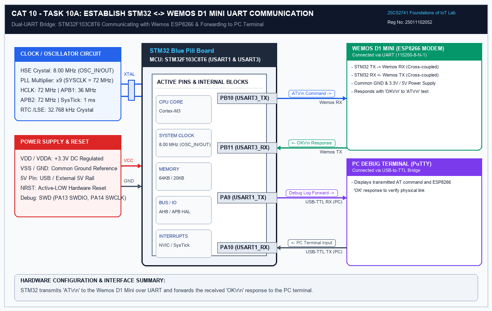

# EXPERIMENT DETAILS

**EXP:** CONTINUOUS ASSESSMENT 10

**DATE:** 05/10/2026

**NAME OF EXP:** STM32–Wemos Wi-Fi Modem Interface Using AT Commands

**HARDWARE SETUP / PLATFORM:** STM32 Blue Pill (STM32F103C8T6) + Wemos D1 Mini (ESP8266) + PC Terminal

---

## TASK 10A : Establish STM32 <-> Wemos D1 Mini UART Communication

### 1. Circuit Diagram

The circuit establishes physical and serial communication between the STM32F103C8T6 microcontroller and an ESP8266-based Wemos D1 Mini Wi-Fi modem.

- **Microcontroller:** STM32F103C8T6 (Blue Pill)
- **Wi-Fi Modem:** Wemos D1 Mini (ESP8266 running Espressif AT Firmware)
- **Modem Link (USART3):** PB10 (USART3_TX) -> Wemos RX; PB11 (USART3_RX) <- Wemos TX; Common GND; 3.3V/5V Power
- **Debug Link (USART1):** PA9 (USART1_TX) -> USB-TTL RX; PA10 (USART1_RX) <- USB-TTL TX (115200-8-N-1)

### 2. Core Logic / Pseudocode / Code Base

**Working Principle:**

Before attempting Wi-Fi networking, the microcontroller must verify physical connectivity with the modem. The STM32 transmits the attention command `"AT
"` over USART3 to the ESP8266. When the modem responds with `"OK
"`, the STM32 reads the characters and mirrors them to the PC terminal over USART1.

**Pseudocode:**
1. Initialize USART1 (PC Debug, 115200 baud) and USART3 (Modem Interface, 115200 baud).
2. Transmit `"AT
"` to Wemos via `HAL_UART_Transmit(&huart3, ...)`.
3. Receive response via `HAL_UART_Receive(&huart3, rx_buffer, sizeof(rx_buffer)-1, 2000)`.
4. Forward received buffer to PC terminal: `HAL_UART_Transmit(&huart1, rx_buffer, ...)`.
5. Verify terminal displays `">> AT"` followed by `"<< OK"`.

### 3. Inference

The ESP8266 responded with `"OK"` upon receiving `"AT
"`, confirming correct baud rates, signal cross-coupling, and functional UART communication.
