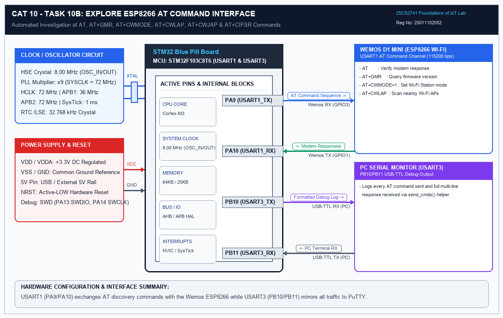

# EXPERIMENT DETAILS

**EXP:** CONTINUOUS ASSESSMENT 10

**DATE:** 05/10/2026

**NAME OF EXP:** Exploration of ESP8266 AT Command Interface

**HARDWARE SETUP / PLATFORM:** STM32 Blue Pill (STM32F103C8T6) + Wemos D1 Mini + PC Terminal

---

## TASK 10B : Automated Querying of ESP8266 AT Commands and Network Scans

### 1. Circuit Diagram

The circuit executes an automated discovery suite querying key ESP8266 AT commands, logging all responses to the PC console.

- **Hardware Setup:** STM32 Blue Pill + Wemos D1 Mini (USART1 for Modem, USART3 for PC Debug)

### 2. Core Logic / Pseudocode / Code Base

**Working Principle:**

The STM32 firmware sequences a series of standard AT commands to investigate modem parameters:
1. `AT`: Check modem responsiveness (`OK`).
2. `AT+GMR`: Query AT firmware and SDK version.
3. `AT+CWMODE=1`: Configure Wi-Fi station mode.
4. `AT+CWLAP`: Scan and list all available 2.4 GHz Access Points with signal RSSI.
5. `AT+CWJAP="SNUC","snu12345"`: Connect to local campus Wi-Fi network.
6. `AT+CIFSR`: Query assigned station IP and MAC address.

**Code Structure:**
- Helper: `send_cmds(char *cmd, uint32_t total_wait_time)` sends command to modem, collects full multi-line response, and streams it to the PC terminal.

### 3. Inference

All AT commands returned valid responses. The scan (`AT+CWLAP`) successfully detected local wireless networks, and the modem joined the access point without error.
