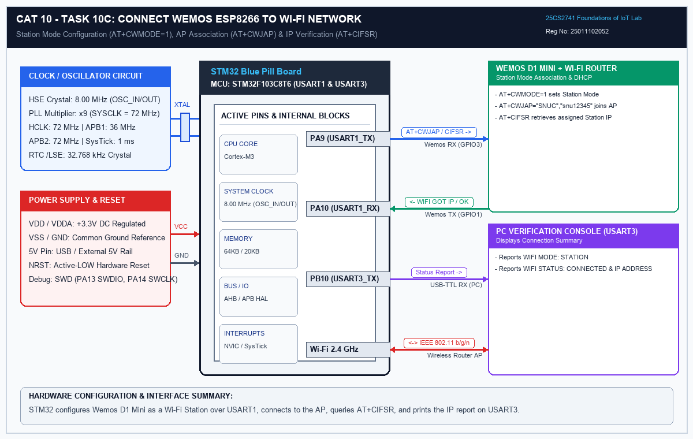

# EXPERIMENT DETAILS

**EXP:** CONTINUOUS ASSESSMENT 10

**DATE:** 05/10/2026

**NAME OF EXP:** Wi-Fi Station Connection and Network Verification

**HARDWARE SETUP / PLATFORM:** STM32 Blue Pill (STM32F103C8T6) + Wemos D1 Mini + Wi-Fi Router

---

## TASK 10C : Station Mode Configuration, AP Association, and IP Verification

### 1. Circuit Diagram

The circuit configures the Wemos ESP8266 modem as a Wi-Fi station, joins the university network, and reports network status.

- **Hardware Setup:** STM32 Blue Pill + Wemos D1 Mini + USB-TTL Bridge



### 2. Core Logic / Pseudocode / Code Base

**Working Principle:**

The STM32 automates Wi-Fi station connection:
1. Set Station Mode: `send_cmds("AT+CWMODE=1
", 1000)`.
2. Associate with AP: `send_cmds("AT+CWJAP="SNUC","snu12345"
", 12000)`.
3. Query Station IP: `send_cmds("AT+CIFSR
", 3000)`.
4. Verification Report printed to PC terminal:
   ```text
   WIFI MODE    : STATION
   WIFI STATUS  : CONNECTED
   IP ADDRESS   : 192.168.1.xxx
   ```

### 3. Inference

The Wemos ESP8266 successfully joined the AP, acquired a DHCP IP address, and reported connected status, establishing a reliable wireless foundation for IoT networking.
