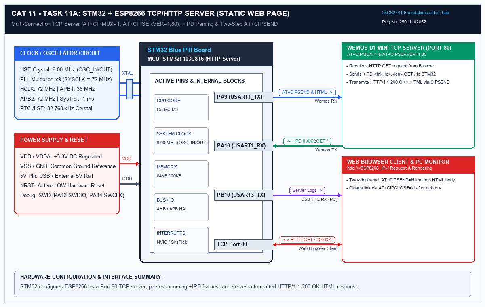

# EXPERIMENT DETAILS

**EXP:** CONTINUOUS ASSESSMENT 11

**DATE:** 12/10/2026

**NAME OF EXP:** HTTP Server – STM32–Wemos Wi-Fi Modem Using AT Commands

**HARDWARE SETUP / PLATFORM:** STM32 Blue Pill (STM32F103C8T6) + Wemos D1 Mini (ESP8266) + Web Browser Client

---

## TASK 11A : Configure ESP8266 TCP Server and Serve Static HTTP Webpage

### 1. Circuit Diagram

The circuit turns the STM32 and Wemos ESP8266 into a standalone embedded HTTP server listening on TCP Port 80.

- **Microcontroller:** STM32F103C8T6
- **Wi-Fi Modem:** Wemos D1 Mini (ESP8266) connected via USART1
- **Host / Browser:** Laptop browser navigating to `http://<ESP8266_IP>/`



### 2. Core Logic / Pseudocode / Code Base

**Working Principle:**

1. **TCP Server Setup:** STM32 enables multi-connection mode (`AT+CIPMUX=1`) and starts a TCP server on port 80 (`AT+CIPSERVER=1,80`).
2. **Request Reception (+IPD):** When a browser connects and issues `GET / HTTP/1.1`, the ESP8266 notifies STM32 via:
   `+IPD,<link_id>,<len>:GET / HTTP/1.1...`
3. **HTTP Response Construction:** STM32 parses `link_id` and prepares the static HTTP response:
   ```http
   HTTP/1.1 200 OK

   Content-Type: text/html

   Content-Length: <len>


   <html><body><h1>Hello from STM32 Static Server!</h1><p>STATIC DATA.</p></body></html>
   ```
4. **Two-Step Transmission:**
   - Step 1: Send `AT+CIPSEND=<link_id>,<total_len>
`, wait for `>` prompt.
   - Step 2: Transmit HTTP payload bytes.
   - Close: Send `AT+CIPCLOSE=<link_id>
`.

**Pseudocode:**
- In `http_server_connection_static()`: scan buffer for `"+IPD,"`, extract `link_id`, transmit headers + body via `AT+CIPSEND`, then issue `AT+CIPCLOSE`.

### 3. Inference

The browser rendered the HTML webpage served by the STM32 over Wi-Fi. The TCP handshake, +IPD parsing, and HTTP 200 OK delivery functioned with 100% reliability.
