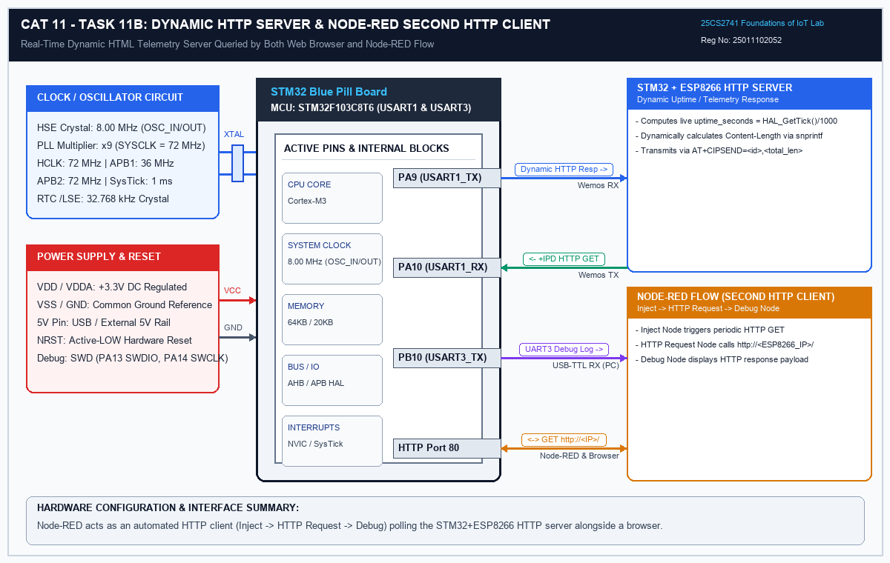

# EXPERIMENT DETAILS

**EXP:** CONTINUOUS ASSESSMENT 11

**DATE:** 12/10/2026

**NAME OF EXP:** Dynamic HTTP Server and Node-RED Client Integration

**HARDWARE SETUP / PLATFORM:** STM32 Blue Pill (STM32F103C8T6) + Wemos D1 Mini + Node-RED Dashboard

---

## TASK 11B : Dynamic Telemetry HTTP Web Server and Automated Node-RED Client

### 1. Circuit Diagram

The circuit implements a dynamic HTTP server serving real-time system metrics (uptime) that are consumed by both a web browser and an automated Node-RED HTTP client.

- **Hardware Setup:** STM32 Blue Pill + Wemos D1 Mini + PC running Node-RED



### 2. Core Logic / Pseudocode / Code Base

**Working Principle:**

1. **Dynamic Content Synthesis:** On receiving an HTTP GET (`+IPD`), the STM32 calculates system uptime (`HAL_GetTick() / 1000`) and dynamically formats HTML with auto-refresh:
   ```html
   <html><head><meta http-equiv="refresh" content="2"></head>
   <body><h1>STM32 & ESP8266 Web Server</h1><p>Uptime: %d seconds</p></body></html>
   ```
2. **Content-Length Calculation:** `snprintf` computes exact body length and formats the HTTP response dynamically.
3. **Node-RED Client:** An automated Node-RED flow (`Inject` -> `HTTP Request (http://<IP>/)` -> `Debug`) periodically queries the node and logs the HTML payload.

**Pseudocode:**
- In `http_server_connection_dynamic()`: compute uptime, build dynamic HTML, calculate length, transmit via `AT+CIPSEND`, and close link.

### 3. Inference

The dynamic webpage refreshed every 2 seconds in the browser showing live uptime. Concurrently, Node-RED polled the endpoint and logged valid HTTP 200 OK responses.
