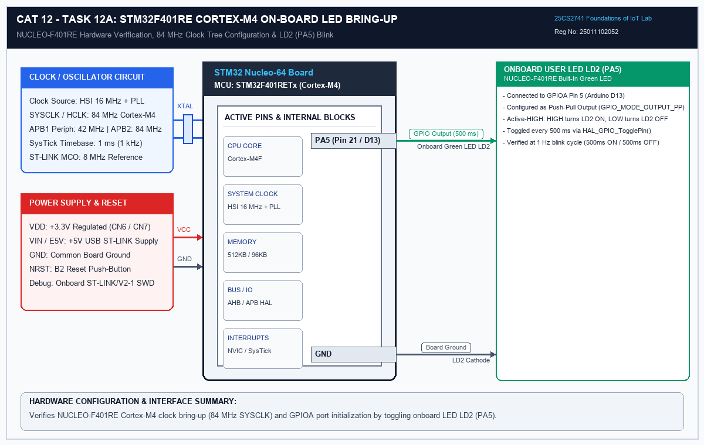

# EXPERIMENT DETAILS

**EXP:** CONTINUOUS ASSESSMENT 12

**DATE:** 14/10/2026

**NAME OF EXP:** STM32F401RE Cortex-M4: GPIO and User Input Programming

**HARDWARE SETUP / PLATFORM:** NUCLEO-F401RE Development Board (Cortex-M4, 84 MHz) + Keil MDK-ARM

---

## TASK 12A : On-Board User LED Bring-Up (NUCLEO-F401RE LD2)

### 1. Circuit Diagram

The circuit verifies hardware bring-up, 84 MHz clock configuration, and GPIO output control on the STMicroelectronics NUCLEO-F401RE Cortex-M4 platform.

- **Development Board:** NUCLEO-F401RE (STM32F401RETx, ARM Cortex-M4 with FPU)
- **Clock Tree:** 16 MHz internal HSI + PLL configured for 84 MHz SYSCLK
- **Onboard Actuator:** User Green LED LD2 connected to GPIOA Pin 5 (Active-High, Arduino D13 pinout)

### 2. Core Logic / Pseudocode / Code Base

**Working Principle:**

The STM32 HAL initializes the Cortex-M4 core, flash latency (2 wait states), and clocks. GPIOA Pin 5 is configured as a push-pull output (`GPIO_MODE_OUTPUT_PP`, low speed). In the main loop, `HAL_GPIO_TogglePin(GPIOA, GPIO_PIN_5)` alternates the LED state every 500 ms (`HAL_Delay(500)`), producing a steady 1 Hz blink.

**Pseudocode:**
1. Call `HAL_Init()` and `SystemClock_Config()`.
2. Enable GPIOA clock: `__HAL_RCC_GPIOA_CLK_ENABLE()`.
3. Configure PA5 as output push-pull.
4. In `while (1)`:
   - `HAL_GPIO_TogglePin(GPIOA, GPIO_PIN_5);`
   - `HAL_Delay(500);`

### 3. Inference

The NUCLEO-F401RE green user LED (LD2) blinked steadily at 1 Hz, confirming successful Cortex-M4 toolchain bring-up, correct clock tree setup, and GPIO HAL functionality.
