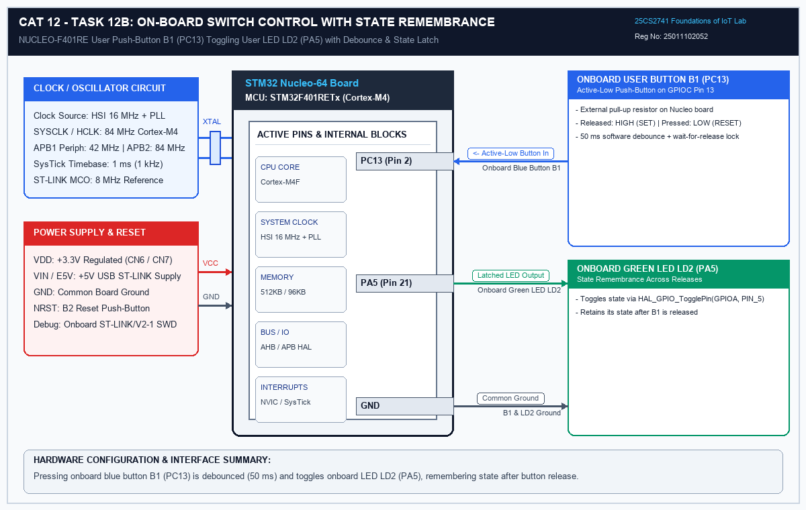

# EXPERIMENT DETAILS

**EXP:** CONTINUOUS ASSESSMENT 12

**DATE:** 14/10/2026

**NAME OF EXP:** On-Board Switch Control with State Remembrance

**HARDWARE SETUP / PLATFORM:** NUCLEO-F401RE Board (STM32F401RETx) + User Button B1 + User LED LD2

---

## TASK 12B : Debounced User Button B1 (PC13) Toggling LED LD2 (PA5) with Memory

### 1. Circuit Diagram

The circuit implements switch-controlled state toggling using the NUCLEO-F401RE onboard blue user push-button B1 (PC13) to control green LED LD2 (PA5).

- **Development Board:** NUCLEO-F401RE
- **Input:** User Button B1 connected to GPIOC Pin 13 (Active-Low)
- **Output:** User LED LD2 connected to GPIOA Pin 5

### 2. Core Logic / Pseudocode / Code Base

**Working Principle:**

Button B1 is pulled HIGH by an onboard resistor. Pressing B1 connects PC13 to GND (`GPIO_PIN_RESET`). The firmware detects the falling edge, executes a 50 ms debounce delay, re-confirms button state, and toggles LD2 via `HAL_GPIO_TogglePin(GPIOA, GPIO_PIN_5)`. It then blocks until release (`while (PC13 == RESET);`), ensuring the LED remembers its new state indefinitely.

**Pseudocode:**
1. Configure PC13 as `GPIO_MODE_INPUT` and PA5 as `GPIO_MODE_OUTPUT_PP`.
2. In `while (1)`:
   - If `HAL_GPIO_ReadPin(GPIOC, GPIO_PIN_13) == GPIO_PIN_RESET`:
     - `HAL_Delay(50);`
     - If still `GPIO_PIN_RESET`:
       - `HAL_GPIO_TogglePin(GPIOA, GPIO_PIN_5);`
       - `while (HAL_GPIO_ReadPin(GPIOC, GPIO_PIN_13) == GPIO_PIN_RESET);`
       - `HAL_Delay(50);`

### 3. Inference

User button B1 toggled LED LD2 with zero bounce glitches. The LED preserved its toggled state after button release, demonstrating reliable state retention on the Cortex-M4.
