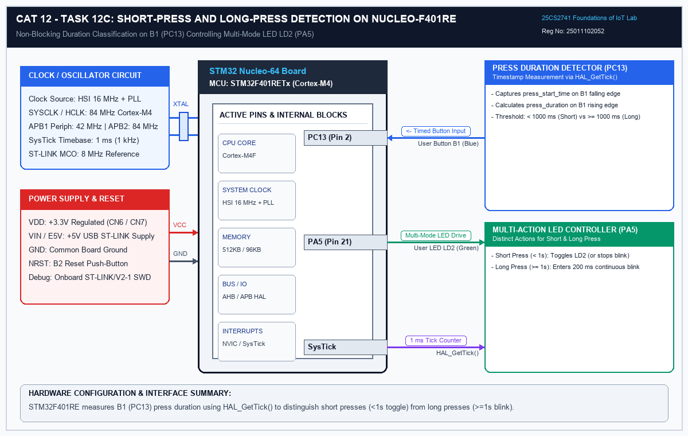

# EXPERIMENT DETAILS

**EXP:** CONTINUOUS ASSESSMENT 12

**DATE:** 14/10/2026

**NAME OF EXP:** Short-Press and Long-Press Detection on Cortex-M4

**HARDWARE SETUP / PLATFORM:** NUCLEO-F401RE Board + User Button B1 (PC13) + User LED LD2 (PA5)

---

## TASK 12C : Non-Blocking Press Classification via HAL_GetTick() on NUCLEO-F401RE

### 1. Circuit Diagram

The circuit extends button input processing on the NUCLEO-F401RE to differentiate short presses (<1s) from long presses (>=1s) using non-blocking SysTick timing.

- **Development Board:** NUCLEO-F401RE
- **Input / Output:** PC13 (Blue Button B1), PA5 (Green LED LD2)

### 2. Core Logic / Pseudocode / Code Base

**Working Principle:**

Press duration is measured using `HAL_GetTick()`:
1. When PC13 is pressed (`RESET`), record `start_time = HAL_GetTick()`.
2. When released, compute `duration = HAL_GetTick() - start_time`.
3. If `duration < 1000 ms` (Short Press):
   - If in blinking mode, stop blinking and turn LED OFF.
   - Else, toggle LED state once.
4. If `duration >= 1000 ms` (Long Press):
   - Enable `blinking_mode = 1` (LED toggles every 200 ms non-blockingly).

**Pseudocode:**
- Non-blocking state machine monitoring press timestamps and driving periodic LED toggling without blocking `HAL_Delay()` calls.

### 3. Inference

Short and long button presses were differentiated reliably. Short presses toggled the LED or stopped blinking, while long presses initiated continuous 200 ms blinking.
