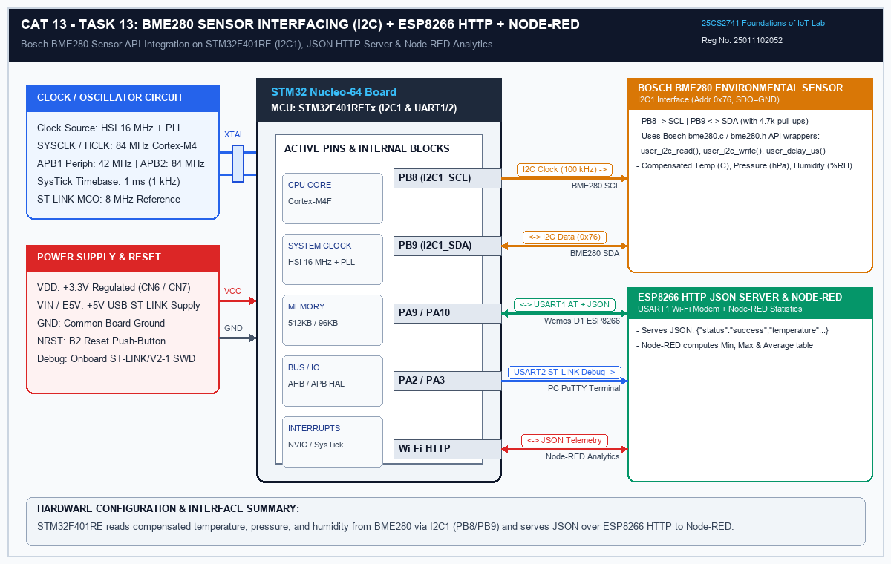

# EXPERIMENT DETAILS

**EXP:** CONTINUOUS ASSESSMENT 13

**DATE:** 23/10/2026

**NAME OF EXP:** BME280 Sensor Interfacing Using I2C and Bosch Sensor API

**HARDWARE SETUP / PLATFORM:** STM32 Nucleo (STM32F401RE) + Bosch BME280 Sensor + Wemos D1 Mini + Node-RED

---

## TASK 13 : I2C Sensor Acquisition, JSON HTTP Server, and Node-RED Analytics

### 1. Circuit Diagram

The circuit implements an environmental telemetry node interfacing a Bosch BME280 sensor over I2C1, formatting calibrated data as JSON, and serving it over HTTP to Node-RED.

- **Microcontroller:** STM32F401RE (Nucleo-64)
- **Sensor:** Bosch Sensortec BME280 (Temperature, Relative Humidity, Barometric Pressure)
- **I2C1 Bus:** PB8 (SCL), PB9 (SDA) with 4.7 kΩ pull-ups, Device Address `0x76` (SDO to GND)
- **Wireless Modem:** Wemos D1 Mini ESP8266 on USART1 (PA9 TX, PA10 RX)
- **Debug Terminal:** ST-LINK Virtual COM Port on USART2 (PA2 TX, PA3 RX) @ 115200 baud



### 2. Core Logic / Pseudocode / Code Base

**Working Principle:**

1. **Hardware Abstraction Layer for Bosch API:**
   - `user_i2c_read()`: wraps `HAL_I2C_Mem_Read()`
   - `user_i2c_write()`: wraps `HAL_I2C_Mem_Write()`
   - `user_delay_us()`: wraps `HAL_Delay()`
2. **Sensor Configuration:** Initializes BME280 (`bme280_init`), sets 1× oversampling for temp, pressure, humidity, filter OFF, and normal power mode.
3. **Data Acquisition & Compensation:** Calls `bme280_get_sensor_data(BME280_ALL, &comp_data, &dev)`. Extracts:
   - Temperature (°C)
   - Pressure ($hPa = Pa / 100.0$)
   - Relative Humidity (%RH)
4. **JSON Serialization & HTTP Delivery:**
   Serializes data: `{"status":"success","temperature":28.45,"humidity":62.30,"pressure":1008.72}`. Computes `Content-Length`, transmits HTTP 200 OK via `AT+CIPSEND`, and sends to Node-RED for statistical aggregation (Min, Max, Average).

**Code Snippet:**
```c
rslt = bme280_get_sensor_data(BME280_ALL, &comp_data, &dev);
if (rslt == BME280_OK) {
    temperature = comp_data.temperature;
    pressure = comp_data.pressure / 100.0f;
    humidity = comp_data.humidity;
}
```

### 3. Inference

The Bosch BME280 API calibrated raw ADC registers into accurate physical units over I2C1. The HTTP server formatted and transmitted JSON payloads seamlessly to Node-RED for real-time analytics.
