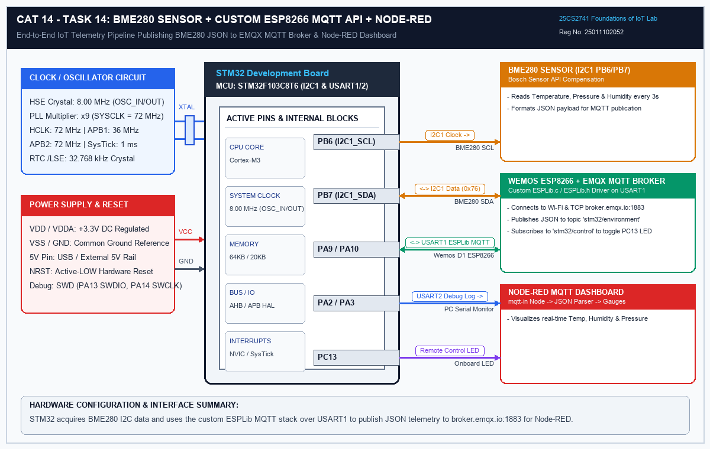

# EXPERIMENT DETAILS

**EXP:** CONTINUOUS ASSESSMENT 14

**DATE:** 27/10/2026

**NAME OF EXP:** BME280 Sensor Interfacing (MQTT) Using Custom Built ESP8266 API

**HARDWARE SETUP / PLATFORM:** STM32 Controller + Wemos D1 Mini + BME280 Sensor + EMQX MQTT Broker + Node-RED

---

## TASK 14 : End-to-End IoT Telemetry Pipeline via Custom ESP8266 MQTT Client

### 1. Circuit Diagram

The circuit creates an end-to-end cloud IoT pipeline using a custom ESP8266 MQTT driver (`ESPLib`) on USART1 to stream BME280 telemetry to an MQTT broker and Node-RED dashboard.

- **Microcontroller:** STM32 Development Board (STM32F103C8T6 / STM32F401RE)
- **Sensor:** Bosch BME280 on I2C1 (PB6 SCL, PB7 SDA)
- **Wi-Fi Modem:** Wemos D1 Mini running ESP-AT firmware on USART1 (PA9/PA10)
- **MQTT Broker:** `broker.emqx.io` on TCP Port 1883
- **Publish Topic:** `"stm32/environment"` (Telemetry JSON)
- **Subscribe Topic:** `"stm32/control"` (Remote LED actuation)

### 2. Core Logic / Pseudocode / Code Base

**Working Principle:**

1. **Custom MQTT Driver (`ESPLib.c` / `ESPLib.h`):** Implements binary MQTT 3.1.1 packet crafting:
   - `MQTT_connectBroker()`: constructs MQTT `CONNECT` packet with clean session and client ID.
   - `MQTT_subscribeTopic()`: sends `SUBSCRIBE` control packet for remote actuation topic.
   - `MQTT_publishTopic()`: crafts QoS 0 `PUBLISH` packet with variable header and payload.
2. **Periodic Telemetry Loop:**
   - Acquire compensated BME280 temperature, pressure, humidity.
   - Format JSON payload: `{"status":"success","temperature":28.45,"humidity":62.30,"pressure":1008.72}`.
   - Publish to topic `"stm32/environment"` every 3 seconds.
3. **Remote Control Handling:**
   - Incoming MQTT packets received via UART interrupt trigger `MQTTDataHandler()`.
   - Payload `"LED_ON"` drives PC13 LOW (LED ON); `"LED_OFF"` drives PC13 HIGH (LED OFF).
4. **Node-RED Dashboard:** Subscribes to `"stm32/environment"` using `mqtt-in` node, parses JSON, and displays values on real-time gauges.

**Pseudocode:**
- Initialize I2C1 and BME280.
- Initialize `ESP8266_Init()`, connect Wi-Fi, open TCP to `broker.emqx.io:1883`.
- Issue `MQTT_connectBroker()`, subscribe to `"stm32/control"`.
- In `while (1)`: sample BME280, publish JSON payload, check for remote commands, delay 3000 ms.

### 3. Inference

The custom embedded MQTT stack successfully maintained continuous communication with the public EMQX broker. BME280 telemetry streamed into Node-RED without packet loss, and bidirectional remote LED control executed with sub-second response times.
