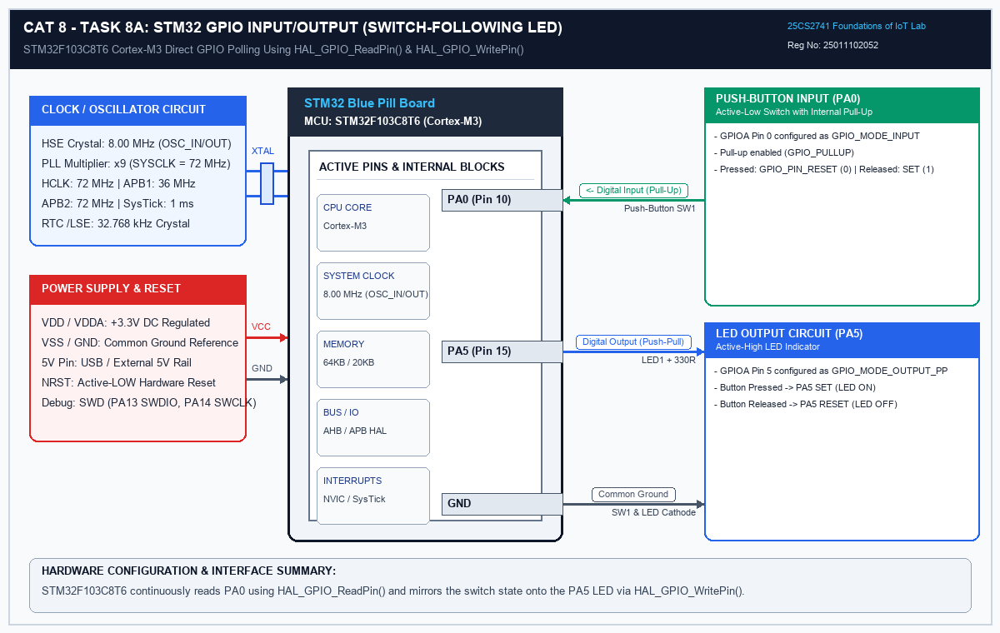

# EXPERIMENT DETAILS

**EXP:** CONTINUOUS ASSESSMENT 8

**DATE:** 18/09/2026

**NAME OF EXP:** STM32 GPIO Bring-Up and Switch-Controlled LED

**HARDWARE SETUP / PLATFORM:** STM32 Blue Pill (STM32F103C8T6) + Tactile Push-Button + User LED + Keil MDK-ARM

---

## TASK 8A : GPIO Input/Output Configuration (Switch-Following LED)

### 1. Circuit Diagram

The circuit demonstrates fundamental GPIO input reading and output driving using the STM32 HAL library on the STM32F103C8T6 Cortex-M3 microcontroller.

- **Development Board:** STM32 Blue Pill (STM32F103C8T6, 72 MHz SYSCLK)
- **Push-Button (Input):** GPIOA Pin 0 (PA0) configured as input with internal pull-up (`GPIO_PULLUP`)
- **User LED (Output):** GPIOA Pin 5 (PA5) configured as push-pull output (`GPIO_MODE_OUTPUT_PP`)
- **Power & Clock:** +3.3V DC rail, 8 MHz HSE crystal boosted to 72 MHz via internal PLL



### 2. Core Logic / Pseudocode / Code Base

**Working Principle:**

GPIOA Pin 0 is held at logic HIGH (+3.3V) by its internal pull-up resistor. Pressing the switch grounds PA0, pulling it to logic LOW (0V, `GPIO_PIN_RESET`). The firmware continuously polls PA0 using `HAL_GPIO_ReadPin()`. When pressed (`RESET`), it asserts PA5 HIGH via `HAL_GPIO_WritePin(GPIOA, GPIO_PIN_5, GPIO_PIN_SET)`, lighting the LED. When released, PA5 is driven LOW (`RESET`), turning the LED OFF.

**Pseudocode:**
1. Initialize HAL and configure system clock to 72 MHz.
2. Initialize GPIO clocks: `__HAL_RCC_GPIOA_CLK_ENABLE()`.
3. Configure PA0 as `GPIO_MODE_INPUT` with `GPIO_PULLUP`.
4. Configure PA5 as `GPIO_MODE_OUTPUT_PP` (Speed: `GPIO_SPEED_FREQ_LOW`).
5. In `while (1)`:
   ```c
   if (HAL_GPIO_ReadPin(GPIOA, GPIO_PIN_0) == GPIO_PIN_RESET) {
       HAL_GPIO_WritePin(GPIOA, GPIO_PIN_5, GPIO_PIN_SET);
   } else {
       HAL_GPIO_WritePin(GPIOA, GPIO_PIN_5, GPIO_PIN_RESET);
   }
   ```

### 3. Inference

The LED directly followed the mechanical switch state with sub-millisecond response latency, successfully verifying GPIO hardware configuration and STM32 HAL pin control.
