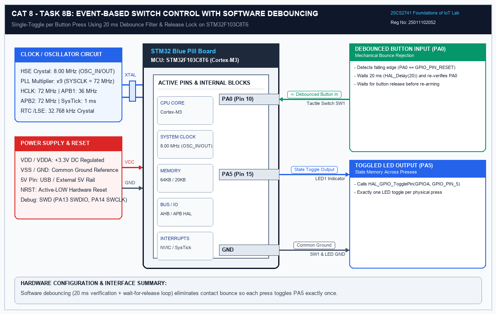

# EXPERIMENT DETAILS

**EXP:** CONTINUOUS ASSESSMENT 8

**DATE:** 18/09/2026

**NAME OF EXP:** Event-Based Switch Control with Software Debouncing

**HARDWARE SETUP / PLATFORM:** STM32 Blue Pill (STM32F103C8T6) + Push-Button Switch + LED + Keil MDK

---

## TASK 8B : Single-Toggle State Memory with 20 ms Debounce Filter

### 1. Circuit Diagram

The circuit implements an event-driven toggle latch where each physical button press toggles the LED state once, rejecting mechanical contact bounce.

- **Development Board:** STM32 Blue Pill (STM32F103C8T6)
- **Input:** PA0 (Tactile push-button with internal pull-up)
- **Output:** PA5 (User LED indicator)

### 2. Core Logic / Pseudocode / Code Base

**Working Principle:**

Mechanical switches exhibit contact bounce lasting 5–15 ms, which can cause spurious toggles. To guarantee deterministic event detection:
1. The firmware detects an initial falling edge (`HAL_GPIO_ReadPin(GPIOA, GPIO_PIN_0) == GPIO_PIN_RESET`).
2. A 20 ms delay (`HAL_Delay(20)`) is introduced to let contact bounce settle.
3. PA0 is re-sampled to verify genuine depression.
4. `HAL_GPIO_TogglePin(GPIOA, GPIO_PIN_5)` flips the LED state.
5. The CPU enters a wait loop (`while (HAL_GPIO_ReadPin(...) == GPIO_PIN_RESET);`) to ensure the button is released before accepting subsequent inputs.

**Pseudocode:**
1. Poll PA0 for LOW state.
2. If LOW: wait 20 ms debounce interval.
3. If still LOW:
   a. Toggle PA5: `HAL_GPIO_TogglePin(GPIOA, GPIO_PIN_5)`.
   b. Wait while PA0 remains LOW.
   c. Wait 20 ms release debounce delay.

### 3. Inference

Mechanical contact bounce was completely eliminated. The LED toggled state exactly once per physical button press, validating robust embedded switch debouncing.
