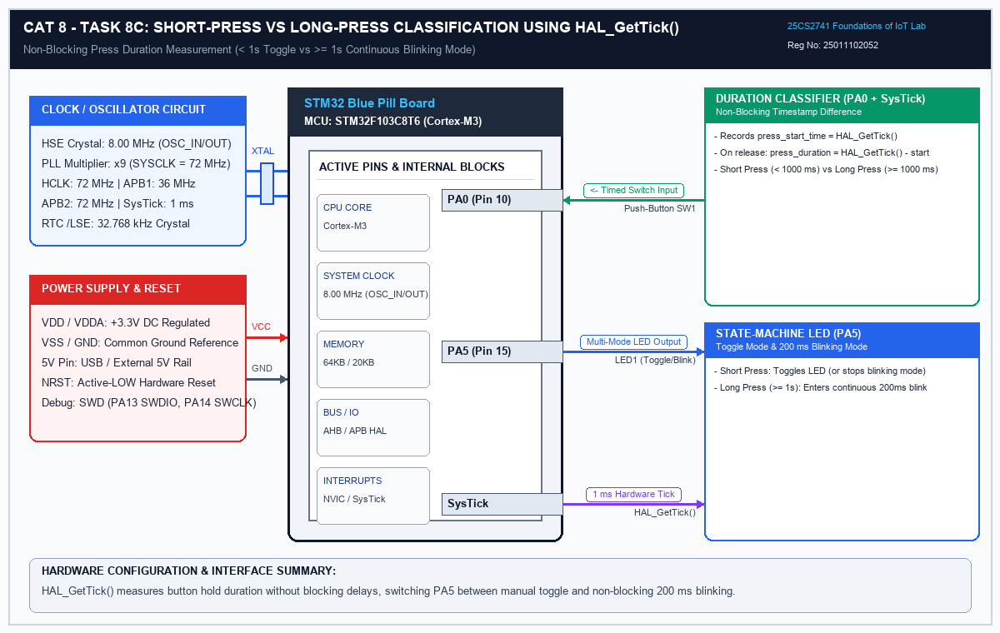

# EXPERIMENT DETAILS

**EXP:** CONTINUOUS ASSESSMENT 8

**DATE:** 18/09/2026

**NAME OF EXP:** Short Press vs Long Press Detection Using SysTick Timebase

**HARDWARE SETUP / PLATFORM:** STM32 Blue Pill (STM32F103C8T6) + Push-Button + LED + Keil MDK

---

## TASK 8C : Non-Blocking Button Duration Classification (<1s Toggle vs >=1s Continuous Blink)

### 1. Circuit Diagram

The circuit classifies button presses based on hold duration using the non-blocking 1 ms SysTick timer (`HAL_GetTick()`).

- **Development Board:** STM32 Blue Pill (STM32F103C8T6)
- **Input:** PA0 (Push-button)
- **Output:** PA5 (LED)
- **Timing Base:** 1 ms ARM Cortex SysTick timer via `HAL_GetTick()`

### 2. Core Logic / Pseudocode / Code Base

**Working Principle:**

The application avoids blocking delays, measuring duration via timestamp deltas:
- **Button Press Detected:** `press_start = HAL_GetTick()`.
- **Button Release Detected:** `press_duration = HAL_GetTick() - press_start`.
- **Classification:**
  - **Short Press (< 1000 ms):** If in blinking mode, stop blinking; otherwise toggle LED state.
  - **Long Press (>= 1000 ms):** Enter continuous blinking mode (toggle LED every 200 ms non-blockingly).

**Pseudocode:**
1. In `while (1)`:
   a. Detect press on PA0 (`RESET`), wait 50 ms debounce.
   b. Record `press_start_time = HAL_GetTick()`.
   c. Wait for release: `while (PA0 == RESET); press_duration = HAL_GetTick() - press_start_time;`.
   d. If `press_duration < 1000`:
      - If `is_blinking`: `is_blinking = 0; HAL_GPIO_WritePin(PA5, RESET);`
      - Else: `HAL_GPIO_TogglePin(GPIOA, GPIO_PIN_5);`
   e. Else (Long Press): `is_blinking = 1;`
   f. If `is_blinking` and `(HAL_GetTick() - last_blink) >= 200`:
      - `HAL_GPIO_TogglePin(GPIOA, GPIO_PIN_5); last_blink = HAL_GetTick();`

### 3. Inference

The non-blocking state machine reliably differentiated short presses from long presses, switching smoothly between static toggle and continuous 200 ms blinking.
