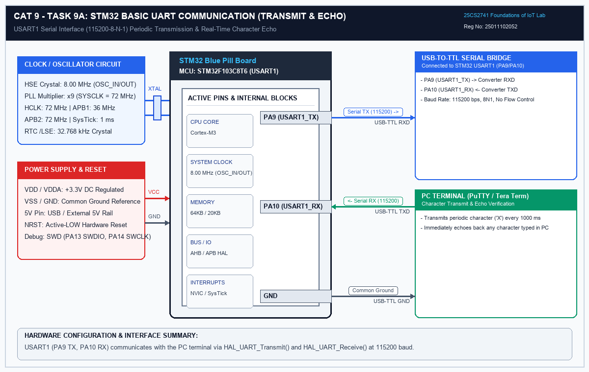

# EXPERIMENT DETAILS

**EXP:** CONTINUOUS ASSESSMENT 9

**DATE:** 28/09/2026

**NAME OF EXP:** STM32 UART Command Controlled LED

**HARDWARE SETUP / PLATFORM:** STM32 Blue Pill (STM32F103C8T6) + USB-to-TTL Serial Bridge + PuTTY Terminal

---

## TASK 9A : Basic UART Character Transmission and Echo (115200-8-N-1)

### 1. Circuit Diagram

The circuit establishes full-duplex asynchronous serial communication over USART1 at 115200 baud between the STM32 microcontroller and a host PC.

- **Development Board:** STM32 Blue Pill (STM32F103C8T6)
- **USART1 Pins:** PA9 (USART1_TX) connected to USB-TTL RXD; PA10 (USART1_RX) connected to USB-TTL TXD
- **Serial Settings:** 115200 Baud, 8 Data bits, No Parity, 1 Stop bit (115200-8-N-1)

### 2. Core Logic / Pseudocode / Code Base

**Working Principle:**

The STM32 HAL UART peripheral (`huart1`) is configured for 115200 bps. The firmware executes two tasks:
1. **Periodic Transmission:** Transmits a periodic test character (`'X'`) every 1000 ms via `HAL_UART_Transmit()`.
2. **Character Reception & Echo:** Polls `HAL_UART_Receive(&huart1, &rx_data, 1, 10)`. When a byte arrives from PuTTY, it is immediately echoed back to the terminal.

**Pseudocode:**
1. Configure USART1: 115200 baud, 8N1, TX/RX mode.
2. In `while (1)`:
   a. Check `HAL_UART_Receive(&huart1, &rx_data, 1, 10)`. If `HAL_OK`:
      - Echo received byte: `HAL_UART_Transmit(&huart1, &rx_data, 1, 100);`
   b. Check if `(HAL_GetTick() - last_tx) >= 1000`:
      - Transmit periodic character `'X'`: `HAL_UART_Transmit(&huart1, &periodic_char, 1, 100);`
      - `last_tx = HAL_GetTick();`

### 3. Inference

USART1 maintained reliable bidirectional communication at 115200 baud. Periodic transmission and interactive character echo functioned flawlessly with zero data corruption.
