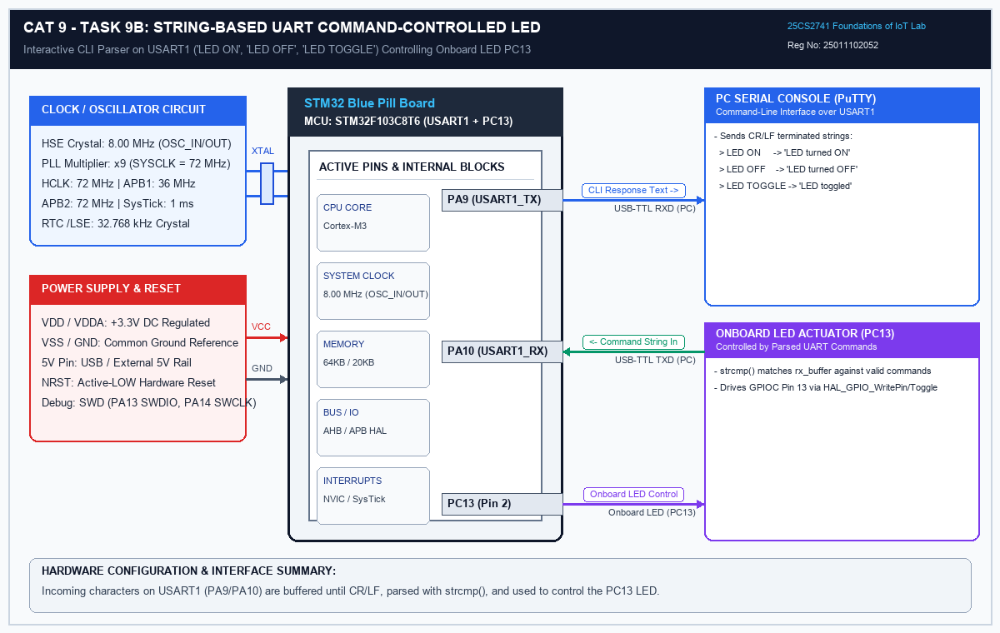

# EXPERIMENT DETAILS

**EXP:** CONTINUOUS ASSESSMENT 9

**DATE:** 28/09/2026

**NAME OF EXP:** String-Based UART Command-Controlled LED Interface

**HARDWARE SETUP / PLATFORM:** STM32 Blue Pill (STM32F103C8T6) + USB-to-TTL Bridge + Onboard LED (PC13)

---

## TASK 9B : Interactive CLI Parser on USART1 Controlling Onboard LED

### 1. Circuit Diagram

The circuit implements a command-line interface (CLI) over USART1 that receives text commands from a PC terminal to control the onboard PC13 LED.

- **Development Board:** STM32 Blue Pill (STM32F103C8T6)
- **Actuator:** Onboard User LED connected to GPIOC Pin 13 (Active-Low)
- **Serial Channel:** USART1 (PA9 TX, PA10 RX) @ 115200 baud

### 2. Core Logic / Pseudocode / Code Base

**Working Principle:**

Characters typed in PuTTY are echoed back and accumulated in a string buffer (`rx_buffer`) until a Carriage Return (`
`) or Line Feed (`
`) is encountered. The firmware then null-terminates the buffer and compares the string:
- `"> LED ON"`: Sets PC13 LOW (`GPIO_PIN_RESET`), turns LED ON, prints `"LED turned ON
"`.
- `"> LED OFF"`: Sets PC13 HIGH (`GPIO_PIN_SET`), turns LED OFF, prints `"LED turned OFF
"`.
- `"> LED TOGGLE"`: Toggles PC13 via `HAL_GPIO_TogglePin()`, prints `"LED toggled
"`.

**Pseudocode:**
1. Poll `HAL_UART_Receive(&huart1, &rx_byte, 1, 5)`.
2. If character received:
   a. Echo character to terminal.
   b. If `rx_byte == '
'` or `'
'`:
      - Null-terminate buffer.
      - If `strcmp(rx_buffer, "LED ON") == 0`: turn LED ON.
      - If `strcmp(rx_buffer, "LED OFF") == 0`: turn LED OFF.
      - If `strcmp(rx_buffer, "LED TOGGLE") == 0`: toggle LED.
      - Reset `rx_index = 0`.
   c. Else: store in `rx_buffer[rx_index++]`.

### 3. Inference

The UART CLI parsed all command strings accurately, providing immediate status messages to the terminal and controlling the onboard PC13 LED reliably.
